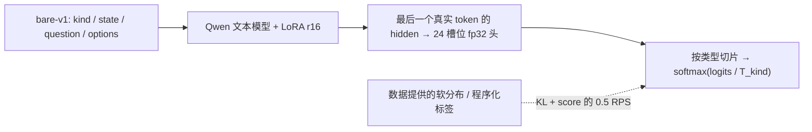

[中文](README.md) | [English](README_EN.md) | [训练细节](docs/training.md) | [评测报告](docs/results.md)

# train-jev: Training JEV-style Decision Models

[](https://huggingface.co/shibing624)
[](LICENSE)
[](requirements.txt)
[](https://github.com/shibing624/train-jev/issues)

**train-jev** 是开源的 System 1 **带类型决策模型**训练与推理框架：在 Qwen 视觉语言底座的文本模型上训练
**LoRA + 24 槽位 fp32 决策头**，从数据提供的完整目标分布学习 KL/RPS，不通过生成答案文本做决策。
本项目独立复现 JEV 的公开配方，与 TypeSafe AI、autotrust 无关联。

**4B 和 27B LoRA 均已完成 5,123 步训练、checkpoint 加载核验及五套评测。** 本仓库提供方法、代码、
固定数据版本、训练/续训/校准/评测命令、报告和 HF 推理包准备工具。结果是有用的可复现基线，**不声称 SOTA**。

## 模型与发布状态

| 模型 | 底座 | LoRA / 决策头参数 | 最佳验证 KL | 状态 |
|---|---|---:|---:|---|
| train-jev 4B | `Qwen/Qwen3.5-4B` | 30.5M / 61,464 | 0.0160 | 训练与评测完成 |
| train-jev 27B r1 | `Qwen/Qwen3.8-27B` | 108.8M / 122,904 | 0.01423 | 训练与评测完成 |

HF 模型：[shibing624/train-jev-4b-lora](https://huggingface.co/shibing624/train-jev-4b-lora)、
[shibing624/train-jev-27b-lora](https://huggingface.co/shibing624/train-jev-27b-lora)。
内容是 LoRA adapter + 自定义 `head.pt` + 温度，不含底座权重，需要用本仓库加载（见下方"部署与推理"）。

## 决策接口

| 类型 | 示例 | 返回 |
|---|---|---|
| `noul` | 订单是否符合退款规则？ | P(true) |
| `choice` | 应交给哪个团队？ | 选项概率和最大概率选项 |
| `score` | 紧急程度 0–5？ | 六级概率和期望分 |

服务接口是 **`POST /v1/systemone`** 和 `GET /health`，可接兼容的 SDK/评测工具。
一个请求可包含多道问题，共享 state，但各问题独立推理、互相看不到答案。温度在独立 calibration split 拟合；
输出是概率估计，**不保证在任意新业务域都已校准**。图像推理目前由独立 `eval_vision` 支持，本地 HTTP 服务只处理文本。

## 方法



- **初始化**：从底座 `lm_head` 复制 `false/true`、`0–5`、`A–P` 的行，bias 为 0；不是随机分类头。
  `scripts/check_init.py` 验证初始受限 next-token 分布一致。
- **LoRA**：r16、alpha32、dropout0.05，覆盖 Gated DeltaNet 的 `in_proj_qkv/in_proj_z/out_proj`，
  全注意力的 `q/k/v/o_proj`，MLP 的 `gate/up/down_proj`。底座参数冻结，决策头可训练。
- **损失**：每行 `weight × [KL(target || p) + 0.5 × RPS]`；RPS 只作用于六级 `score`。
  累加 micro-batch 后按全局 batch 128 归一化，不按 micro-batch 数或权重和归一化。
- **数据**：固定 `jev-distill-corpus-v3` train 655,806 行；实际来源为 yuri_v3 443,977、openjev_v2 74,626、
  yuri_v1 137,203。来源名不等于全部标签都由同一个 API 生成。占位/均匀二选项按现有启发式降权到 0.05。
- **采样**：每步每种类型先取 `floor(128/6)=21` 行，再从全池抽满 128；按 step 固定 RNG。
  这是跨步重新采样，不是无放回遍历。5,123 步 = 655,744 次样本呈现，约一 epoch **等价采样量**。
- **增强**：30% choice 题置换选项，并同步置换目标分布。训练 choice 最多 16 个选项。
- **优化**：AdamW beta=(0.9,0.98)，weight decay0，LoRA/head lr=1e-4/2e-4，3% warmup、cosine 至 0.02 倍，
  全局 grad norm 裁剪 1。每 500 步固定 4,000 行 validation，以最低 KL 选 best。
- **校准**：排除占位行后在 calibration 拟合分类型温度；不使用 test 标签调温度。

完整公式、模板、padding、分词截断、DDP/FSDP2、数据独立性与数值边界，见 [训练文档](docs/training.md)。
固定种子/输入/预算使实验可追踪复现；**不承诺跨 GPU 数、库版本、bf16 合并和部署后端逐位相同**。

## 已完成结果

同题对比；DI 是 **原 6,000 请求的 35 基准重算面板，不是完整官方总分**。
4B/27B r1 的宽题用 tournament，原 JEV 的历史宽题用 single，后端也不同，不能据此隔离读法增益。

| 指标 | 4B LoRA | 27B LoRA r1 | 原 JEV-27B-VL |
|---|---:|---:|---:|
| test KL，6,000 行，校准后 ↓ | 0.02239 | **0.01853** | 0.02075 |
| OOD KL，3,000 行 ↓ | 0.31073 | 0.11006 | **0.10842** |
| DI 35，6,000 请求 ↑ | 40.35 | **54.57** | 54.11 |
| transfer-v4 accuracy，656 行 ↑ | 77.90% | 85.06% | **85.21%** |
| transfer-v4 ECE ↓ | 0.07468 | **0.05308** | 0.09731 |
| transfer-v4 NLL ↓ | 0.74455 | **0.41130** | 0.46022 |
| PK accuracy，1,300 行 ↑ | 64.69% | 67.77% | **69.00%** |
| PK ECE ↓ | **0.07569** | 0.10294 | 0.094 |
| 视觉 mean skill，5 集合等权 ↑ | 0.69729 | 0.75999 | **0.78195** |

27B 明显优于当前 4B，但相对原 JEV 有优势也有弱项；DI +0.46 未估计配对置信区间，不据此称全面超越。
4B 全参对照未胜出，所以本轮 27B 选择 LoRA。单 seed、采样面板、状态共享与硬件差异均在
[主报告 §8/§10](docs/results.md) 明确记录。旧协议主链路不依赖 HLE/HoVer；完整 37 面板是独立后续分支。

## 安装与固定版本

```bash
git clone https://github.com/shibing624/train-jev
cd train-jev
pip install -r requirements.txt
```

Python >=3.12；参考环境 Python3.12.11、torch2.13.0+cu129、transformers5.17.0、peft0.21.0、
flash-linear-attention0.5.2。`requirements-tested.txt` 记录实测版本，不是所有 CUDA/平台通用锁文件。
先按硬件安装匹配的 torch/torchvision CUDA wheels；CPU 测试安装方式见 CI。`causal-conv1d` 未用于主结果，
不要把换 kernel 后的结果自动当作逐位复现。

### 数据与底座版本

| 输入 | 固定 HF revision |
|---|---|
| `SargeDev/jev-distill-corpus-v3` | `75111a13a8455032f0435050bfc7e0c9026ecfe8` |
| `Qwen/Qwen3.5-4B`（post-trained，不是 -Base） | `851bf6e806efd8d0a36b00ddf55e13ccb7b8cd0a` |
| `Qwen/Qwen3.8-27B` | `1d4bf0f2ff6012fd82039f2fa52739d0dd7c60c0` |

```bash
bash scripts/prepare_data.sh
BASE_REPO=Qwen/Qwen3.8-27B BASE_DIR=models/Qwen3.8-27B bash scripts/prepare_data.sh
```

脚本按固定 revision 下载，支持 `HF_ENDPOINT`、`DATA_REVISION`、`BASE_REVISION` 显式覆盖。
请记录覆盖后的版本，不能只保留同名目录。新数据先运行 `scripts/audit_training_data.py`，不回灌评测错题。

## 训练、续训与校准

```bash
# 4B：参考三卡、关闭 gradient checkpointing
GPUS=0,1,2 SAVE_STATE_EVERY=100 bash scripts/run_train.sh
# 27B：本轮实测四卡、开启 gradient checkpointing
GPUS=0,1,2,3 SAVE_STATE_EVERY=100 bash scripts/run_train_27b.sh
# 冒烟：只提前停止，学习率 schedule 仍为完整 5,123 步
GPUS=0 MAX_STEPS=3 OUT=runs/smoke bash scripts/run_train.sh
# 从相同输出目录的 optimizer/RNG/DCP 状态继续，GPU 数与配置不变
GPUS=0,1,2,3 RESUME=1 OUT=runs/jev-27b bash scripts/run_train_27b.sh
```

best/step checkpoint 是**推理包**，不等于完整续训状态。完整状态在 `state/`（必要时回退 `state.old/`）；
缺少状态时 `--resume` 会失败，不会悄悄从头训。日志追加保存。间隔 100 的 5,123 步 run 最后 DCP 为 5,100，
最终推理权重为 step05123。实测 4B LoRA 3+3 续训与直跑6步的 adapter/head 完全一致。

```bash
CKPT=runs/jev-4b/best bash scripts/run_eval.sh
BASE=models/Qwen3.8-27B CKPT=runs/jev-27b/best OUT=eval/jev-27b bash scripts/run_eval.sh
```

| 实测训练 | 显存峰值/卡 | 耗时（含周期验证，不含最终评测） |
|---|---:|---:|
| 4B，3×H20，no_gc，micro_tokens4096 | 约48.8 GB | 2.77 h |
| 27B，4×H20，GC，micro_tokens16384 | 74.9 GB | 33.07 h，23.24 s/step |

当前实现只训练文本模型。图像推理加载完整 VL 底座并应用文本 adapter；启用/合并 adapter 后的生成行为
没有单独验证，不宣称其生成能力完全不变。

## 部署与推理 demo

```bash
BASE=models/Qwen3.5-4B CKPT=runs/jev-4b/best PORT=8020 STRATEGY=tournament bash scripts/run_serve.sh
python examples/client.py --url http://127.0.0.1:8020
python examples/batch_decisions.py --url http://127.0.0.1:8020
python examples/smoke_systemone.py --url http://127.0.0.1:8020
python examples/wide_choices.py --url http://127.0.0.1:8020 --compare
python examples/local_inference.py --base models/Qwen3.5-4B --adapter runs/jev-4b/best --device cuda
```

4B 推理示例已实际运行：固定三题 smoke 为 3/3，noul/choice/score 输出结构、概率范围与归一化通过；
20 个意图的三种读法均选 duplicate_payment。**这些是使用验证，不是泛化准确率或速度 benchmark**。
完整示例见 [examples](examples/)。

上传 HF 后可传 repo ID，服务会下载 adapter、head 和 calibration，而不只下载 LoRA：

```bash
python -m trainjev.serve --base models/Qwen3.5-4B --adapter shibing624/train-jev-4b-lora \
  --adapter_revision v0.2.0 --port 8020 --strategy tournament
```

模型 tag `v0.2.0` 对应代码 tag
[v0.2.0](https://github.com/shibing624/train-jev/tree/v0.2.0)。默认 single 与历史 tournament 分数不是同一个协议。

### 宽选项

训练只覆盖 A–P；single/permute 超过16时额外行来自底座 lm_head，bias0。合法 token 标签不保证宽题效果。
同一4B checkpoint、CLINC150/BANKING77/MASSIVE en各600题的实际对照：

| 策略 | accuracy（1,800） | ECE ↓ | p50 |
|---|---:|---:|---:|
| single（默认） | 72.67% | 0.1622 | 52.3 ms |
| tournament | 73.22% | **0.0499** | 108.9 ms |
| permute | **77.11%** | 0.2180 | 171.2 ms |

permute 更准但主要欠置信；tournament 在 MASSIVE en 比 single 低6pp。默认未改；后校准需独立 dev，
不拿这批 test 标签调温度。公式、配对统计、请求追踪见 [报告 §7](docs/results.md#7-wide-choice-questions-17256-options)。

## 评测与发布

[docs/evaluation.md](docs/evaluation.md) 给出五套评测的固定样本、评分、同题比较和缺失面板处理；
不要把数据、底座权重、DCP/RNG、API 密钥或原始运行日志提交到代码仓库。

## TODO：下一版 4B / 27B

- [x] 4B LoRA/全参对照、27B LoRA完整训练和旧协议五套评测；代码/报告公开。
- [x] 4B 宽选项三策略600题/场景对照，记录精度、校准、延迟；不据单指标自动改默认。
- [x] 数据审计、完整状态续训、HF checkpoint加载与推理 demo；HF上传仍需实际执行确认。
- [ ] 独立 dev 选择宽题策略与后平均温度；保留独立 final test，不回灌测试题。
- [ ] 4B-v2：核验金标来源/revision/split/许可证，补知识推理与语言覆盖；按 state、原始 group/反事实组隔离。
- [ ] 固定控制组和完整 LR schedule，逐项比较实际金标采样剂量、标签软化、2/4/8/16选项覆盖；每次只改一个变量。
      固定步数/batch/micro-token预算，并报告实际输入tokens与padding，不能把上限当成相同总算力。
- [ ] 数据固定后再试LoRA r32/r64或全参；全参不是预定赢家。短探针用 `STEPS=5123 MAX_STEPS=400`，不缩成400步schedule。
- [ ] 胜出4B完整训练并重复seed，独立dev/校准/视觉门槛通过后迁移27B-v2；同题验证是否超过当前r1和原JEV。
- [ ] 完整DI37与vLLM精度分支独立跟进，不阻塞旧35主结果，不把新旧面板或部署实现混比。
- [x] 发布4B/27B HF权重（tag `v0.2.0`，code revision `cb73b78`）；9B是后续计划，未训练。

## License / Citation / Contact

代码按 [Apache-2.0](LICENSE) 授权；底座、训练/评测数据遵循各自条款。

```bibtex
@misc{train-jev,
  title={train-jev: Training JEV-style Decision Models},
  author={Ming Xu},
  year={2026},
  howpublished={\url{https://github.com/shibing624/train-jev}}
}
```

作者：Ming Xu / shibing624；[Issues](https://github.com/shibing624/train-jev/issues)，邮件 xuming624@qq.com。
感谢 [autotrust/JEV-27B-VL](https://huggingface.co/autotrust/JEV-27B-VL)、SargeDev、Open-Jev、
[jaredpalmer/kev](https://github.com/jaredpalmer/kev)、[Decision Index](https://github.com/apolinario/decision-index)、Qwen、fla。
贡献流程见 [CONTRIBUTING.md](CONTRIBUTING.md)。
