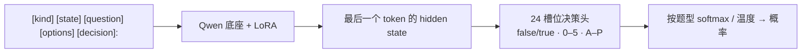

[**🇨🇳中文**](README.md) | [**🌐English**](README_EN.md) | [**📖文档**](docs/) | [**🤖模型**](https://huggingface.co/shibing624/train-jev-27b-lora)

# train-jev

自己训练、自己部署的 JEV 式决策模型：一次前向，给出校准过的概率。

[](https://huggingface.co/shibing624/train-jev-27b-lora)
[](https://github.com/shibing624/train-jev/actions/workflows/ci.yml)
[](LICENSE)
[](requirements.txt)
[](https://github.com/shibing624/train-jev/issues)

**train-jev** 开源复现了 JEV（TypeSafe Jev v1.13）的 System 1 决策模型配方：
在 Qwen3.5 / Qwen3.8 底座上训练 **LoRA + 24 槽位决策头**，用 KL 蒸馏 Jev v1.13 的完整输出分布。
模型不生成文本，而是在一次前向里直接给出每个选项的**概率**，可以直接拿来当置信度。

服务接口兼容 TypeSafe [System One API](https://docs.typesafe.ai/api)（`POST /v1/systemone`），
已经在调用 Jev 的代码只要换个地址就能接上。

## 特性

- **三种决策题型，一个请求问完**：是非题（`noul`）、选择题（`choice`）、打分题（`score`）共享同一段文本，各题独立作答、互不可见。
- **概率默认已校准**：每个模型都带按题型拟合的温度，返回的概率可以直接设阈值。
- **开箱即用的权重**：4B 和 27B 两个 LoRA 模型（v0.3.0）发布在 Hugging Face，一行命令启动服务。
- **27B 超过 autotrust/JEV-27B-VL**：封存的 2,494 题同题 PK 上宏平均准确率 78.7% 对 73.5%（配对 +5.25pp，95% 区间 [4.01, 6.50]），
  公开金标、旧分类、规则三类都领先；transfer-v4 上 ECE 0.032 对 0.097。
- **能看图**：只用文本训练，底座的视觉编码器保持不变，训完的模型可以零样本对图像做决策。
- **训练模型，服务部署**：单文件训练脚本，多卡 DDP / FSDP2，支持断点续训；换个 `--base` 就能换底座。

## 模型

| 模型 | 版本 | 底座 | 可训练参数 | 推理显存 | 下载 |
|---|---|---|---:|---|---|
| **shibing624/train-jev-4b-lora**（Ours） | v0.3.0 | Qwen3.5-4B | LoRA 30.5M + 决策头 61k | 24 GB | [🤗 HF](https://huggingface.co/shibing624/train-jev-4b-lora) |
| **shibing624/train-jev-27b-lora**（Ours） | v0.3.0 | Qwen3.8-27B | LoRA 108.8M + 决策头 123k | 80 GB | [🤗 HF](https://huggingface.co/shibing624/train-jev-27b-lora) |

v0.2.0 权重保留在 HF 的 `v0.2.0` tag，用 `--adapter_revision v0.2.0` 加载。

## 效果

所有模型都在**同一批题**上评测。↑ 越高越好，↓ 越低越好。下表 train-jev 两列均为 **v0.3.0**。

| 评测 | train-jev-4b-lora<br>（Ours） | train-jev-27b-lora<br>（Ours） | Kev-4B | autotrust/JEV-27B-VL | TypeSafe Jev v1.13<br>（官方 API） |
|---|---:|---:|---:|---:|---:|
| **封存同题 PK**（2,494 题，22 个任务，2026-10-17） | | | | | |
| 任务宏平均准确率 ↑ | 74.18% | **78.72%** | 63.50% | 73.47% | – |
| 公开金标（PAWS / AQuA / QASC / HelpSteer2） ↑ | 63.25% | **70.65%** | 56.70% | 62.24% | – |
| 旧分类任务（12 个） ↑ | 69.89% | **74.89%** | 70.11% | 72.67% | – |
| 精确规则任务（6 类） ↑ | 90.06% | **91.77%** | 54.79% | 82.57% | – |
| 校准后 NLL ↓ | 0.751 | **0.629** | 1.018 | 0.761 | – |
| ECE ↓ | 0.112 | **0.098** | 0.159 | 0.107 | – |
| **13 数据集分类 PK**（1,300 题） | | | | | |
| 准确率 ↑ | 0.642 | 0.687 | 0.640 | 0.690 | **0.700** |
| ECE ↓ | 0.050 | **0.048** | 0.083 | 0.094 | 0.130 |
| Kev 没见过的 8 个来源，准确率 ↑ | 0.600 | 0.640 | 0.570 | **0.645** | **0.645** |
| **Kev transfer-v4**（656 题，训练时没见过的来源） | | | | | |
| 准确率 ↑ | 0.805 | **0.858** | 0.817 | 0.852 | 0.857 |
| ECE ↓ | 0.054 | **0.032** | 0.042 | 0.097 | – |
| NLL ↓ | 0.596 | **0.377** | 0.435 | 0.460 | – |
| **Decision Index 0.3，历史采样**（35 个基准，6,000 题） ↑ | 41.5 | ⏳ | 38.4 | 54.1 | **59.7** |
| **Decision Index 0.3，公开文本全量**（37 个基准，110,087 请求，`single`） ↑ | 39.01 | ⏳ | – | – | – |
| **蒸馏保真度**（jev-distill，原始 logits） | | | | | |
| 分布内 KL ↓ | 0.023 | **0.019** | 0.387 | 0.021 | – |
| 分布外 KL ↓ | 0.483 | 0.123 | 0.624 | **0.108** | – |
| **零样本看图决策**（5 个视觉集） ↑ | 0.693 | 0.765 | 不支持 | **0.782** | – |
| 单题延迟 p50 | 42 ms | 151 ms | **17 ms** | 96 ms | 370 ms（含网络） |

- **train-jev-27b-lora 超过 autotrust/JEV-27B-VL**：封存 PK 上配对宏平均 **+5.25pp [4.01, 6.50]**；分项公开金标 +8.41pp、
  旧分类 +2.22pp [0.61, 3.90]、规则 +9.20pp；transfer-v4 准确率 0.858 对 0.852，ECE 0.032 对 0.097，NLL 0.377 对 0.460。
  看图决策和分布外 KL 仍略低于 JEV-27B-VL。
- **train-jev-4b-lora 在同尺寸里领先 Kev-4B**：封存 PK +10.69pp [8.89, 12.59]，transfer-v4 0.805 对 0.817 略低但 ECE 更好，
  Decision Index 历史 35 基准 41.5 对 38.4；4B 与 JEV-27B-VL 在封存 PK 上统计持平（+0.71pp [−0.82, 2.34]）。
- 差距：TypeSafe Jev v1.13 官方 API 在 13 数据集 PK 和历史 35 基准 Decision Index 上仍然最好。
- 封存 PK 的规则任务与 v0.3.0 训练用的规则族相同（新样本），公开金标来自训练里出现过的 4 个来源（不同题目），
  所以这两项的领先说明的是同分布学习，不是对未见规则或来源的泛化；transfer-v4、13 数据集 PK 和 Decision Index 才是分布外检验。
- 分布外 KL 衡量与 Jev v1.13 教师分布的贴合度：v0.3.0 加入金标监督后，4B 从 0.311 升到 0.483，27B 从 0.110 升到 0.123，
  准确率没有下降（4B OOD top-1 choice 0.888→0.900）。蒸馏 KL 统一用原始 logits，因为 v0.3.0 的温度是在金标校准集上拟合的。
- 延迟口径：train-jev 为进程内 merged-BF16、单题一次前向；Kev-4B / JEV-27B-VL / Jev API 沿用 v0.2.0 时的测量，口径不同，只看量级。

v0.2.0 → v0.3.0 的同题对比、配方说明和开发集选点见下文 [v0.3.0](#v030金标--规则数据续训)；全部明细见 [结果文档](docs/results.md)。

评测口径、逐项明细和更多对比见 [docs/results.md](https://github.com/shibing624/train-jev/blob/main/docs/results.md)。

## 快速开始

### 安装

```bash
git clone https://github.com/shibing624/train-jev.git && cd train-jev
pip install -r requirements.txt
```

### 启动服务

```bash
python -m trainjev.serve --base Qwen/Qwen3.5-4B --adapter shibing624/train-jev-4b-lora --port 8020
```

首次运行会自动下载底座、LoRA、决策头和温度。换成 27B：
`--base Qwen/Qwen3.8-27B --adapter shibing624/train-jev-27b-lora`。

### 发一个请求

```bash
curl -s localhost:8020/v1/systemone -H 'content-type: application/json' -d '{
  "state": "快递晚到了两周，鞋码还发错了。另外我的卡上被扣了两次款。",
  "questions": {
    "department":  {"type": "choice", "instructions": "这条工单应该交给哪个团队？",
                    "criteria": {"售后": "换货、退款、发错或损坏的商品",
                                 "物流": "配送状态、延误、丢件",
                                 "财务": "扣款、发票、支付问题"}},
    "escalate":    {"type": "noul",  "instructions": "是否需要人工紧急介入？"},
    "frustration": {"type": "score", "instructions": "客户的不满程度？",
                    "criteria": ["平静", "不满", "非常愤怒"]}
  }}'
```

train-jev-4b-lora 的实际返回（概率保留两位小数）：

```json
{
  "answers": {
    "department":  {"type": "choice", "choice": "售后",
                    "probabilities": {"售后": 0.59, "物流": 0.21, "财务": 0.20}},
    "escalate":    {"type": "noul", "noul": 0.74},
    "frustration": {"type": "score", "score": 1.43,
                    "probabilities": {"0": 0.00, "1": 0.57, "2": 0.43}}
  }
}
```

这张工单同时涉及发错货、物流延误和重复扣款，所以 `department` 没有给出一边倒的答案。
这正是返回概率而不是单个标签的意义：你的代码可以只自动处理高置信度的情况，其余的交给人工。

### 在 Python 里调用

```python
import httpx

resp = httpx.post("http://127.0.0.1:8020/v1/systemone", json={
    "state": "I was charged twice. Please fix this ASAP.",
    "questions": {
        "billing": {"type": "noul", "instructions": "Is this ticket about billing?"},
        "tone": {"type": "choice", "instructions": "What is the customer's tone?",
                 "criteria": {"calm": None, "frustrated": None, "angry": None}},
    },
}, timeout=60).json()

if resp["answers"]["billing"]["noul"] > 0.9:
    print("route to billing:", resp["answers"]["tone"]["choice"])
```

更多示例见 [examples/](https://github.com/shibing624/train-jev/blob/main/examples/) 和 [部署与推理文档](https://github.com/shibing624/train-jev/blob/main/docs/serving.md)。

## 用自己的数据训练

训练数据是 jsonl，每行一道带目标分布的题：

```json
{"kind": "choice", "state": "...", "question": "Which team should handle this?",
 "options": ["billing", "infra", "product"], "target": [0.05, 0.90, 0.05], "weight": 1.0}
```

```bash
bash scripts/prepare_data.sh                       # 下载 jev-distill 语料和 Qwen3.5-4B 底座
GPUS=0,1,2 bash scripts/run_train.sh               # 4B：3 张 H20 约 2.8 小时
GPUS=0,1,2,3 bash scripts/run_train_27b.sh         # 27B：4 张 H20 约 33 小时
```

用 `--mix mydata.jsonl:2` 把自己的数据混进去。训练配方、断点续训、温度校准和显存估算见 [docs/training.md](https://github.com/shibing624/train-jev/blob/main/docs/training.md)。

## 工作原理



决策头的 24 行从底座 `lm_head` 里对应 token（`false/true`、`0–5`、`A–P`）的行初始化，所以训练开始时模型的输出就等于底座本身的判断，
训练只是在此基础上把判断"磨锋利"。损失是对教师分布的 KL，打分题再加 0.5 倍的 RPS 序数损失；
训练时随机打乱 30% 选择题的选项，让模型按内容而不是位置作答。详见 [docs/training.md](https://github.com/shibing624/train-jev/blob/main/docs/training.md)。

## v0.3.0：金标 + 规则数据续训

4B 和 27B 用**同一个配方**：以各自的 v0.2.0 LoRA + 决策头为起点（优化器重置）续训。
新训练池为 GSM8K 双干扰项视图、PAWS、AQuA-RAT、QASC、HelpSteer2，以及独立校验的规则/证据/指代/退款/日历/条件计数样本；
**每步 87.5% 旧蒸馏回放、12.5% 新监督**，LoRA / 决策头学习率 2e-5 / 4e-5，seed 17，2,048 步学习率表。
输入里不放参考解析或教师派生文本。checkpoint 只在独立开发集上挑选（宏平均最高且超过 16 个选项的题不退步），两者都选中**第 512 步**。

| 训练 | 硬件 | 实际步数 | 发布 checkpoint | 耗时 |
|---|---|---:|---:|---:|
| 4B | 3×H20，不开 gradient checkpointing | 2,048 | 512 | 1.3 h |
| 27B | 3×H20，gradient checkpointing，micro-token 16,384 | 1,024 | 512 | 7.9 h |

**封存同题 PK**（2,494 题、22 个任务；评分前两个模型的 checkpoint 都已选定；不是 Decision Index 分数）：

| 指标 | 4B v0.2.0 | **4B v0.3.0** | 27B v0.2.0 | **27B v0.3.0** | Kev-4B | JEV-27B-VL |
|---|---:|---:|---:|---:|---:|---:|
| 任务宏平均准确率 | 63.59% | 74.18% | 73.99% | **78.72%** | 63.50% | 73.47% |
| 公开金标 | 57.03% | 63.25% | 63.41% | **70.65%** | 56.70% | 62.24% |
| 旧分类任务 | 70.22% | 69.89% | 73.44% | **74.89%** | 70.11% | 72.67% |
| 精确规则任务 | 54.69% | 90.06% | 82.14% | **91.77%** | 54.79% | 82.57% |
| 校准后 NLL ↓ | 1.050 | 0.751 | 0.725 | **0.629** | 1.018 | 0.761 |
| ECE ↓ | 0.165 | 0.112 | 0.117 | **0.098** | 0.159 | 0.107 |
| 反事实双题全对 | 0.346 | 0.866 | 0.742 | **0.892** | 0.330 | 0.746 |
| 选项轮转一致率 | 0.844 | **0.911** | 0.901 | 0.901 | 0.870 | 0.880 |
| 单题延迟 p50 / p95（ms） | – | 42 / 100 | – | 151 / 353 | 97 / 251 | 135 / 324 |

配对宏平均差（group-bootstrap 95% 区间）：

| 对比 | 全部 | 公开金标 | 旧分类 | 规则 |
|---|---:|---:|---:|---:|
| 4B v0.3.0 − 4B v0.2.0 | **+10.60** [9.44, 11.77] | +6.22 | −0.33 | +35.38 |
| 27B v0.3.0 − 27B v0.2.0 | **+4.73** [3.71, 5.80] | +7.24 | +1.44 [0.37, 2.66] | +9.63 |
| 27B v0.3.0 − JEV-27B-VL | **+5.25** [4.01, 6.50] | +8.41 | +2.22 [0.61, 3.90] | +9.20 |
| 4B v0.3.0 − Kev-4B | **+10.69** [8.89, 12.59] | +6.55 | −0.22 | +35.27 |
| 4B v0.3.0 − JEV-27B-VL | +0.71 [−0.82, 2.34] | +1.02 | −2.78 [−5.25, −0.42] | +7.49 |

- **增益来源**：4B 的提升约九成来自规则任务；27B 的提升更均衡，公开金标 +7.2pp、旧分类也显著上升。
  控制实验中只续训不加新数据（D0）增益为 0，只加 GSM8K 不显著，所以提升来自公开金标 + 规则数据，不是多训了几步。
- **分布外检验**：4B Decision Index 37 基准全量 37.40 → 39.01（配对题级 +0.97pp [0.78, 1.17]，25 升 / 10 降，#38 等 3 个基准显著下降）；
  transfer-v4 准确率 4B 0.779 → 0.805、27B 0.851 → 0.858，ECE 都下降；13 数据集 PK 4B 持平（24 / 30 独有正确，p=0.50），
  27B 0.678 → 0.687（25 / 13，p=0.073）。分布外的提升明显小于同分布 PK。
- **局限**：规则题与训练规则族相同、公开金标来源在训练里出现过（题目不同），每个尺寸只训了一个种子。
  每个模型都用自己原生的推理方式和自带温度，外部模型没有重训或重拟合温度；延迟在同一台 H20 但推理栈不同，只看量级。
- 明细：[reports/v0.3.0/external_final2.json](reports/v0.3.0/external_final2.json)（六模型逐任务）、
  [reports/v0.3.0/final_pk.json](reports/v0.3.0/final_pk.json)（4B 发布验收）、[docs/results.md §13](docs/results.md#13-v030金标--规则数据续训)。

## 文档

| 文档 | 内容 |
|---|---|
| [docs/serving.md](https://github.com/shibing624/train-jev/blob/main/docs/serving.md) | 部署与推理：服务参数、API 格式、示例、超过 16 个选项的读法 |
| [docs/training.md](https://github.com/shibing624/train-jev/blob/main/docs/training.md) | 训练配方、数据格式、断点续训、温度校准、显存与速度、换底座 |
| [docs/evaluation.md](https://github.com/shibing624/train-jev/blob/main/docs/evaluation.md) | 五套评测怎么跑、怎么复现 |
| [docs/results.md](https://github.com/shibing624/train-jev/blob/main/docs/results.md) | 全部评测结果、逐项明细和局限 |

## Roadmap

- [x] Qwen3.5-4B / Qwen3.8-27B LoRA 训练、评测并发布到 Hugging Face（v0.2.0）
- [x] 加入公开金标和规则数据续训，27B 在封存同题 PK 上超过 JEV-27B-VL（v0.3.0）
- [ ] 更广的公开金标数据，补齐知识推理和语言理解上和 TypeSafe Jev v1.13 的差距
- [ ] 训练 Full-finetune 的 Qwen3.8-27B
- [ ] `/v1/systemone` 服务支持图像输入

### v0.4.0：memory-write 场景（不改动 v0.3.0 配方）

- [ ] 从实际 SDK 导出完整 schema、标签、请求模板和概率字段；先复现真实请求，将已确认的 8 条失败样本保留为回归测试，RPC 超时单独排查。
- [ ] 构建分组隔离的 memory-write 正负例，覆盖事实、闲聊、重复/更新/矛盾、引用/工具输出、隐私及不持久化约束；使用 Jev 1.13 teacher 的完整分布并复核标签，不以 teacher 一致性代替正确性。
- [ ] 派生记忆抽取单独作为生成器或 System Two 任务，保留原文证据；不把生成文本任务混同于 System One 分类，也不靠派生条数判断质量。
- [ ] 在更大的独立留出集评估写入精确率/召回率、标签宏 F1、校准及派生事实覆盖、重复与幻觉率；8 条回归用例不能作为泛化效果报告。

## Citation

```bibtex
@misc{train-jev,
  title={train-jev: Training JEV-style Decision Models},
  author={Ming Xu},
  year={2026},
  howpublished={\url{https://github.com/shibing624/train-jev}}
}
```

## Contact

- GitHub Issue：[](https://github.com/shibing624/train-jev/issues)
- 邮件：xuming624@qq.com
- 微信群：添加微信号 `xuming624`，备注 "llm"，加入技术交流群


欢迎贡献，流程见 [CONTRIBUTING.md](https://github.com/shibing624/train-jev/blob/main/CONTRIBUTING.md)。

## 致谢

- [autotrust/JEV-27B-VL](https://huggingface.co/autotrust/JEV-27B-VL) 公开配方，
- [SargeDev/jev-distill-corpus-v3](https://huggingface.co/datasets/SargeDev/jev-distill-corpus-v3) 提供训练语料，
- [jaredpalmer/kev](https://github.com/jaredpalmer/kev) 的评测集和对照模型，
- [Decision Index](https://github.com/apolinario/decision-index)，以及 [Qwen](https://huggingface.co/Qwen) 底座。

本项目是独立的算法研究复现，与 TypeSafe AI、autotrust 均无关联。

## License

代码采用 [Apache-2.0](https://github.com/shibing624/train-jev/blob/main/LICENSE)。Qwen 底座同为 Apache-2.0；训练和评测数据遵循各自的许可。
