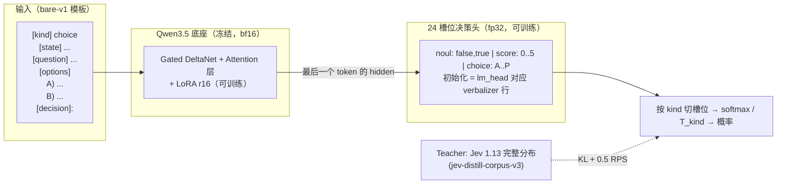

[**🇨🇳中文**](https://github.com/shibing624/train-jev/blob/main/README.md) | [**🌐English**](https://github.com/shibing624/train-jev/blob/main/README_EN.md) | [**📖文档/Docs**](docs/) | [**🤖模型/Models**](https://huggingface.co/shibing624)

-----------------

# train-jev: Training JEV-style Decision Models

[](https://huggingface.co/shibing624)
[](https://star-history.com/#shibing624/train-jev&Timeline)
[](CONTRIBUTING.md)
[](LICENSE)
[](requirements.txt)
[](https://github.com/shibing624/train-jev/issues)
[](#-contact)

## 📖 Introduction

**train-jev** 是一个开源的 **System 1 决策模型（typed-decision model）训练框架**，完整复现了 JEV（[autotrust/JEV-27B](https://huggingface.co/autotrust/JEV-27B)）的训练方法：
在 Qwen3.5 底座上加 **LoRA + 24 槽位决策头**，用 **KL 蒸馏** TypeSafe Jev 1.13 的完整输出分布，一次前向就给出**校准过的概率**。

决策模型回答的不是开放问题，而是带类型的问题：

| 类型 | 问题示例 | 输出 |
|---|---|---|
| `noul` | 这条工单是平台级故障吗？ | P(true) |
| `choice` | 这条工单该派给哪个团队？（2–16 个选项，>16 个用锦标赛扩展到 256） | 每个选项的概率 |
| `score` | 这条工单紧急程度是多少？（0–5 级） | 6 级分布 + 期望分 |

**train-jev** 提供从数据、训练、校准、评测到部署的完整链路：

- **训练**：`torchrun` 多卡 DDP，单个文件实现完整的 JEV 配方（LoRA r16 + fp32 决策头 + KL/RPS 损失 + 选项置换增强 + 按类型分层采样）。
- **校准**：按问题类型拟合温度，输出的概率可以直接当置信度用。
- **评测**：4 套评测，覆盖分布内蒸馏、分布外泛化、公开基准（[Decision Index](https://github.com/apolinario/decision-index) 0.3）和零样本看图决策。
- **部署**：兼容 TypeSafe [System One API](https://docs.typesafe.ai/api) 的 `POST /v1/systemone` 服务，也兼容 JEV 的 `/v1/decide`，现有 SDK 和评测工具不用改就能接上。
- **看图决策**：只用文本训练，Qwen3.5 自带的视觉编码器不动，训完的模型可以零样本对图像做决策。

> 本项目是独立的算法研究复现，与 TypeSafe AI、autotrust 均无关联。

## 🔥 News

[2026/10/14] v0.1.0 版本：首次发布。在 Qwen3.5-4B 上复现 JEV 训练配方：3×H20 训练 2.8 小时，分布内 KL 0.018，和官方 JEV-27B（0.017）基本持平；零样本图像决策 skill 从 0.632 提到 0.697。同时支持 Qwen3.8-27B 底座（JEV-27B 的同款底座），并开源 13 个数据集的分类 PK 评测。完整结果见 [docs/results.md](docs/results.md)。

## 😊 Features

- **一次前向出分布**：不生成文本，在 prompt 最后一个 token 上读 24 槽位决策头，4B 模型单请求 p50 约 43 ms（H20）。
- **训练前就和底座一致**：决策头从 `lm_head` 中对应 verbalizer token（`false/true`、`0–5`、`A–P`）的行初始化，第 0 步的输出与底座受限 next-token 分布相同（实测 |Δp| = 7.7e-6）。蒸馏只是在预训练能力上做锐化。
- **可训练参数少**：LoRA 30.5M（占底座 0.7%）+ 决策头 61k，训练时底座冻结。
- **覆盖 Qwen3.5 的混合架构**：LoRA 同时覆盖 Gated DeltaNet 层（`in_proj_qkv / in_proj_z / out_proj`）和全注意力层。批处理统一用右 padding，线性注意力层的递推状态不会被 padding 污染。
- **按选项内容而不是位置作答**：训练时随机打乱 30% `choice` 题的选项（目标分布同步置换）。
- **结果可复现**：固定种子，每一步的采样在所有 rank 上一致；本仓库代码与原始实验代码在相同输入下逐位一致（训练 loss、评测 logits、服务输出、图像概率差值均为 0）。

## 🧠 Method



| 配置项 | 取值 |
|---|---|
| 底座 | `Qwen/Qwen3.5-4B`（训练时只用文本塔；图像推理时加载完整 VL 模型） |
| 数据 | [`SargeDev/jev-distill-corpus-v3`](https://huggingface.co/datasets/SargeDev/jev-distill-corpus-v3) `train` 655,806 行：Jev 1.13 蒸馏 49.8 万、Open-Jev 程序化标签 9.5 万、`yuri_v1` 占位标签 14.8 万（权重 ×0.05） |
| LoRA | r=16，α=32，dropout 0.05，10 类投影：`in_proj_qkv, in_proj_z, out_proj, q/k/v/o_proj, gate/up/down_proj` |
| 损失 | KL(teacher ‖ model)，`score` 额外加 0.5 × RPS（ranked probability score） |
| 增强 | 30% 的 `choice` 题随机打乱选项顺序 |
| 批次 | 每步 128 行，按类型分层（每种类型 ≥ 1/6），按长度分桶 |
| 优化器 | AdamW（fused），β=(0.9, 0.98)，LoRA lr 1e-4 / 头 lr 2e-4，warmup 3%，余弦退火到 0.02×，梯度裁剪 1.0，1 个 epoch（5,123 步） |
| 选 checkpoint | 每 500 步在固定 4k 验证子集上算 KL，取最低的 |
| 校准 | 在 `calibration` 集上按类型拟合温度（排除占位行）：noul 1.008 / choice 1.004 / score 0.998 |

方法细节和每个设计选择的理由见 [docs/training.md](docs/training.md)。

### 支持的底座

Qwen3.5 / 3.6 / 3.8 系列共用同一套词表和 `qwen3_5` 架构（Gated DeltaNet + 全注意力混合），verbalizer token id 一致，代码不用改，换 `--base` 就行。

| 底座 | 层数（其中全注意力） | hidden | LoRA 参数 | 状态 |
|---|---:|---:|---:|---|
| Qwen3.5-4B | 32（8） | 2560 | 30.5M | ✅ 完整训练和评测（本文结果） |
| Qwen3.5-9B | 32（8） | 4096 | — | 🔜 下一步 |
| **Qwen3.8-27B**（JEV-27B 底座） | 64（16） | 5120 | 108.8M | ✅ 已验证：加载、初始化检查（\|Δp\| = 0）、训练、语料和图像评测都能跑通；完整训练 🔜 |
| Qwen3.5-2B / 27B、Qwen3.6-27B | — | — | — | 词表、verbalizer、架构检查通过 |

Qwen3.8-27B 的 config 和 autotrust/JEV-27B-VL 完全一致，LoRA（108.8M）和决策头（123k）的参数量也和 JEV-27B 模型卡一致。

## 📊 Results

以下都是 **train-jev 4B**（Qwen3.5-4B + JEV 配方）的结果，每个评测里所有模型用的是同一批题。

### 分布内：蒸馏 Jev 1.13 的保真度

`test_set_30k` 抽 6,000 题，KL 越低越好；"Jev 标注"指标签来自 Jev 1.13 的那部分题。

| 模型 | 参数量 | KL（全部） | KL（Jev 标注） | noul AUROC | choice top-1 | score MAE |
|---|---:|---:|---:|---:|---:|---:|
| Qwen3.5-4B（未训练，初始化后的决策头） | 4B | 0.637 | 0.658 | 0.816 | 0.511 | 1.371 |
| Kev-4B | 4B | 0.387 | 0.364 | 0.861 | 0.575 | 0.779 |
| **train-jev 4B** | 4B | **0.022** | **0.018** | **0.995** | **0.908** | **0.104** |
| JEV-27B-VL | 27B | 0.021 | 0.017 | 0.996 | 0.908 | 0.098 |
| *参考：JEV-27B 官方报告* | *27B* | *0.019* | *0.017* | *0.996* | *0.903* | *0.098* |

验证集 KL 曲线和官方 JEV-27B 基本重合：第 500 步 0.060（官方 0.058），收敛到 0.016（官方 0.017）。

### 分布外和公开基准

| 评测 | Kev-4B | **train-jev 4B** | JEV-27B-VL | 说明 |
|---|---:|---:|---:|---|
| Decision Index 0.3 公开指数（35/37 个基准，6,000 题分层抽样）↑ | 38.4 | **40.4** | 54.1 | 榜单 4B 参考（同口径重算）：vLLM-SR d3-mini 56.1，ezjev-4B 52.9，Sieve-4B 51.5 |
| jev-distill `ood`（未见过的任务族，程序化标签），KL ↓ | 0.624 | **0.311** | 0.108 | 官方 JEV-27B 0.104 |
| Kev `transfer-v4`（656 题，训练时没见过的来源），准确率 ↑ | **0.817** | 0.779 | 0.852 | 官方 Jev 1.13 0.857 |
| 单请求 p50 延迟（H20，HF transformers） | 17 ms | 43 ms | 96 ms | Jev 1.13 托管 API 370 ms（含网络） |

### 零样本图像决策

训练时完全没有图像。下表是 Decision Index 视觉集每个集合 300 题的 chance-corrected skill（0 = 随机猜，1 = 全对）：

| 模型 | CV-Bench | BLINK | RealWorldQA | CharXiv | InfoVQA | **均值** |
|---|---:|---:|---:|---:|---:|---:|
| Qwen3.5-4B（未训练，初始化后的决策头） | 0.682 | 0.454 | 0.510 | 0.667 | 0.847 | 0.632 |
| **train-jev 4B** | **0.732** | **0.506** | **0.608** | **0.729** | **0.913** | **0.697** |
| JEV-27B-VL | 0.743 | 0.634 | 0.711 | 0.849 | 0.973 | 0.782 |

只用文本蒸馏，5 个视觉集都有提升，均值 +6.5 个百分点。Kev 加载时去掉了视觉塔，不能处理图像。

### 13 个公开数据集的分类 PK

1,300 题（13 个数据集 × 100 题），涵盖 choice / score / boolean 三种题型和中英两种语言。所有系统用同一套固定问题，不做任务级 prompt 调优。题库可以用 `scripts/pk_build.py` 从公开数据集逐字节重建。其中 5 个数据集的来源在 Kev 的训练数据里，单独列出。

| | Jev 1.13（API） | JEV-27B-VL | Kev-4B | **train-jev 4B** |
|---|---:|---:|---:|---:|
| 准确率（1,300 题） | 0.700 | 0.690 | 0.640 | **0.647** |
| ECE ↓ | 0.130 | 0.094 | 0.083 | **0.076** |
| Kev 训练过的来源（5 个，500 题） | 0.788 | 0.762 | 0.752 | 0.718 |
| **Kev 没见过的来源（8 个，800 题）** | 0.645 | 0.645 | 0.570 | **0.603** |

只看 Kev 没见过的 8 个数据集，train-jev 4B 比 Kev-4B 高 3.3 个百分点，校准也是四个模型里最好的（ECE 0.076）。

### 结论

1. **配方复现正确**：分布内 KL（0.018）、验证集曲线、校准温度（都接近 1.0）都和官方 27B 的报告吻合。
2. **4B 的容量是主要瓶颈**：一到分布外、知识推理、类别很多的意图分类，就和 27B 拉开差距。Decision Index 上 train-jev 4B（40.4）和 Kev-4B（38.4）在同一档，离 4B 第一梯队（51–56）还差 11–16 分。
3. **保留看图能力是这套方法的独特优势**：同尺寸的 Kev-4B 不支持图像。

Decision Index 各领域分数、PK 评测、各 checkpoint 的训练曲线，以及评测口径说明，见 [docs/results.md](docs/results.md)。

## 💾 Install

```shell
git clone https://github.com/shibing624/train-jev
cd train-jev
pip install -r requirements.txt
```

- 这是训练仓库，不发布成 Python 库。依赖装好后，在仓库根目录运行，例如 `python -m trainjev.train`。
- Python ≥ 3.12；需要 `transformers>=5.17`（支持 Qwen3.5/3.8，`transformers` 4.x 不认识 `qwen3_5` 架构）、`peft>=0.21`、`torch>=2.6`。
- CUDA 上强烈建议装 `flash-linear-attention==0.5.2`，否则 Gated DeltaNet 层会退回到很慢的 PyTorch 实现。

#### Hardware Requirement (显存/VRAM)

| 配置 | 每卡峰值显存 | 速度 | 一个 epoch（5,123 步） |
|---|---:|---:|---:|
| 3× H20 96GB，`--no_gc --micro_tokens 4096`（参考配置） | 48.8 GB | 1.94 s/步 | 2.8 小时 |
| 1× H20 96GB，`--no_gc --micro_tokens 4096` | 48.8 GB | 4.5 s/步 | 约 6.4 小时 |
| 显存不够时：开 gradient checkpointing（默认，去掉 `--no_gc`） | 更低 | 更慢 | — |
| **Qwen3.8-27B**：1× H20 96GB，gradient checkpointing，`--micro_tokens 16384` | 75 GB | 约 50 s/步 | 约 70 GPU 小时 |

推理：4B 模型 bf16 权重约 9.3 GB，单张 24 GB 显卡即可部署；27B 约 54 GB（文本塔），需要 80 GB 级显卡。

## 🚀 Quick Start

### 1. 准备数据和底座

```shell
bash scripts/prepare_data.sh   # 下载 jev-distill-corpus-v3 到 data/，下载 Qwen3.5-4B 到 models/
```

### 2. 训练前检查（可选，推荐）

```shell
python scripts/check_init.py --base models/Qwen3.5-4B --data data/jev-distill-corpus-v3
# equivalence gate: rows 96  max|dp| = 7.7e-06  -> PASS
```

### 3. 训练

```shell
GPUS=0,1,2 bash scripts/run_train.sh                          # 参考配置：3 卡，约 2.8 小时
GPUS=0 MAX_STEPS=20 OUT=runs/smoke bash scripts/run_train.sh   # 冒烟测试
```

产物：`runs/jev-4b/{step00500,...,best}/`，每个目录里有 LoRA adapter（`adapter_model.safetensors`）和决策头（`head.pt`）。

### 4. 校准和评测

```shell
CKPT=runs/jev-4b/best bash scripts/run_eval.sh   # 拟合温度 → best/calibration.json，并在 test_set_30k / ood 上评测
```

### 5. 部署（System One API）

```shell
CKPT=runs/jev-4b/best PORT=8020 bash scripts/run_serve.sh
python examples/client.py --url http://127.0.0.1:8020
```

```shell
curl -s localhost:8020/v1/systemone -H 'content-type: application/json' -d '{
  "state": "Ticket #4821: every CSV export fails with a 504 after 60s. Status page: all systems operational.",
  "questions": {
    "is_outage": {"type": "noul", "instructions": "Is this most likely a platform-wide outage?"},
    "route": {"type": "choice", "instructions": "Which team should handle this first?",
              "criteria": {"billing": "payments", "infra": "timeouts and capacity", "product": "feature requests"}}
  }}'
```

同一个请求里的多个问题共享 state，但彼此看不到对方，按长度分桶后一起批处理。

### 6. 公开基准和图像评测

```shell
# Decision Index 0.3：首次需要构建题库（见脚本头部注释），然后
URL=http://127.0.0.1:8020 NAME=jev-4b bash scripts/run_decision_index.sh

# 零样本图像决策
python -m trainjev.eval_vision --base models/Qwen3.5-4B --adapter runs/jev-4b/best \
    --di_root third_party/decision-index --out eval/vision-jev-4b

# 13 个公开数据集的分类 PK（1,300 题）
python scripts/pk_build.py --out data/pk
python scripts/pk_benchmark.py run --url http://127.0.0.1:8020 --suite data/pk --out eval/pk_jev-4b.jsonl
python scripts/pk_benchmark.py report jev-4b=eval/pk_jev-4b.jsonl
```

完整评测流程见 [docs/evaluation.md](docs/evaluation.md)。

### 7. 换成 Qwen3.8-27B 底座

```shell
huggingface-cli download Qwen/Qwen3.8-27B --local-dir models/Qwen3.8-27B
python scripts/check_init.py --base models/Qwen3.8-27B             # PASS
GPUS=0,1,2,3,4,5,6,7 bash scripts/run_train_27b.sh                 # -> runs/jev-27b/best
```

## ✅ TODO

- [x] 在 Qwen3.5-4B 上复现 JEV 配方（LoRA + 24 槽位头 + KL/RPS），对齐官方 JEV-27B 的训练曲线和分布内 KL
- [x] 温度校准、System One 兼容服务、>16 选项锦标赛
- [x] 5 套评测：jev-distill（分布内/外）、Decision Index 0.3、Kev transfer-v4、零样本图像决策、13 数据集分类 PK
- [x] 适配 Qwen3.8-27B 底座（JEV-27B 同款）：加载、初始化检查、训练、评测已跑通
- [ ] **在当前 LoRA 配方的基础上，用 "jev-distill + 更广的公开金标数据" 做一轮全参微调**（或高 rank LoRA）。目标是补上和 4B 第一梯队差距最大的两块：Knowledge & Reasoning（0.32 vs 0.44）和 Language Understanding（0.39 vs 0.58）。榜上排名靠前的 4B 模型（d3-mini、RSI-Jev 4B）都用了全参微调。
- [ ] 混入金标数据时保住校准：硬标签容易让模型过度自信，计划试 label smoothing，或对金标部分单独拟合温度
- [ ] 训练 Qwen3.5-9B 和 Qwen3.8-27B 两个尺寸，跑全套评测
- [ ] 发布 train-jev 4B / 9B / 27B 权重到 Hugging Face
- [ ] 图像决策加入 `/v1/systemone` 服务（目前只在评测脚本中支持）

## ☎️ Contact

- Issue(建议)：[](https://github.com/shibing624/train-jev/issues)
- 邮件我：xuming: xuming624@qq.com
- 微信我：加我*微信号：xuming624, 备注：姓名-公司名-NLP* 进NLP交流群（加我拉你进群）。

## ⚠️ LICENSE

本项目仅可应用于研究目的，项目开发者不承担任何因使用本项目（包含但不限于数据、模型、代码等）导致的危害或损失。

train-jev 项目代码的授权协议为 [The Apache License 2.0](LICENSE)，代码可免费用做商业用途。训练数据、评测数据和底座模型请遵守各自的协议：[jev-distill-corpus-v3](https://huggingface.co/datasets/SargeDev/jev-distill-corpus-v3)（Apache-2.0，要求注明来源）、[Qwen3.5 / Qwen3.8](https://huggingface.co/Qwen)（Apache-2.0）、PK 评测用到的各公开数据集。请在产品说明中附加 train-jev 的链接和授权协议。

## 😇 Citation

如果你在研究中使用了 train-jev，请按如下格式引用：

```latex
@misc{train-jev,
  title={train-jev: Training JEV-style Decision Models},
  author={Ming Xu},
  year={2026},
  howpublished={\url{https://github.com/shibing624/train-jev}},
}
```

## 😍 Contribute

欢迎提交改进。提交 PR 之前请注意两点：

- 在 `tests` 里添加相应的单元测试
- 用 `python -m pytest` 运行所有单元测试，确保全部通过

详见 [CONTRIBUTING.md](CONTRIBUTING.md)。

## 💕 Acknowledgements

- [autotrust/JEV-27B](https://huggingface.co/autotrust/JEV-27B)、[autotrust/JEV-27B-VL](https://huggingface.co/autotrust/JEV-27B-VL)：训练配方、prompt 模板和 `serve_decide.py` 的参考实现
- [SargeDev/jev-distill-corpus-v3](https://huggingface.co/datasets/SargeDev/jev-distill-corpus-v3)：训练数据
- [ZefanCai/Open-Jev](https://huggingface.co/datasets/ZefanCai/Open-Jev)：OOD 任务族与程序化标签
- [jaredpalmer/kev](https://github.com/jaredpalmer/kev)：Kev 系列模型与 `transfer-v4` 评测套件
- [apolinario/decision-index](https://github.com/apolinario/decision-index)：Decision Index 复现工具
- [Jev's Architecture Unmasked](https://archerhume.com/posts/jevs-architecture-unmasked)：Jev 架构分析
- [Qwen3.5](https://huggingface.co/Qwen)、[flash-linear-attention](https://github.com/fla-org/flash-linear-attention)

Thanks for their great work!

#### 关联项目推荐

- [shibing624/MedicalGPT](https://github.com/shibing624/MedicalGPT)：训练医疗大模型，实现了增量预训练、有监督微调、RLHF、DPO、ORPO、GRPO 和 OPD
- [shibing624/agentica](https://github.com/shibing624/agentica)：基于 LLM 构建 Agent 的框架
