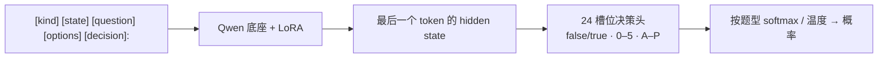

[**🇨🇳中文**](README.md) | [**🌐English**](README_EN.md) | [**📖文档**](docs/) | [**🤖模型**](https://huggingface.co/shibing624/train-jev-27b-lora)

# train-jev

自己训练、自己部署的 JEV 式决策模型：一次前向，给出校准过的概率。

[](https://huggingface.co/shibing624/train-jev-27b-lora)
[](https://github.com/shibing624/train-jev/actions/workflows/ci.yml)
[](LICENSE)
[](requirements.txt)
[](https://github.com/shibing624/train-jev/issues)

**train-jev** 提供 JEV 式 System 1 决策模型的训练、评测和部署代码，以及开箱即用的 **4B / 27B LoRA 权重**。
在 Qwen3.5 / Qwen3.8 底座上训练 **LoRA + 24 槽位决策头**，先学习 Jev v1.13 的输出分布，再用公开金标和规则数据增强判断能力。
模型不生成文本，而是直接返回每个选项的**概率**：让代码自动处理高置信度的判断，其余交给人工。

服务接口兼容 TypeSafe [System One API](https://docs.typesafe.ai/api)（`POST /v1/systemone`），已经在调用 Jev 的代码只要换个地址就能接上。

## 特性

- **三种决策题型，一个请求问完**：是非题（`noul`）、选择题（`choice`）、打分题（`score`）共享同一段文本，各题独立作答。
- **概率默认已校准**：模型附带按题型拟合的温度，便于设置自动处理与人工复核的阈值；新领域可重新校准。
- **开箱即用**：4B 和 27B 两个 LoRA 模型已发布在 Hugging Face，一行命令启动服务。
- **准确率高、校准误差低**：27B 在封存同题 PK 上达到 78.72% 宏平均准确率，transfer-v4 上 ECE 为 0.032。
- **能看图**：`trainjev.serve --vision` 支持 TypeSafe 风格的图片 `assets`，可用 JSON/base64 或 multipart 上传，在同一个 `/v1/systemone` 请求里问是非、选择和打分题；见[图片接口](docs/serving.md#图片输入typesafe-assets)。
- **可复用的训练方法**：KL 蒸馏、金标监督、规则数据回放、多卡 DDP / FSDP2 和断点续训，支持混入自己的标注数据。

## 模型

| 模型 | 底座 | 可训练参数 | 推理显存 | 下载 |
|---|---|---:|---|---|
| **shibing624/train-jev-4b-lora**（Ours） | Qwen3.5-4B | LoRA 30.5M + 决策头 61k | 24 GB | [🤗 HF](https://huggingface.co/shibing624/train-jev-4b-lora) |
| **shibing624/train-jev-27b-lora**（Ours） | Qwen3.8-27B | LoRA 108.8M + 决策头 123k | 80 GB | [🤗 HF](https://huggingface.co/shibing624/train-jev-27b-lora) |

## 效果

> **本地候选构建 `v0.4.0-di-priority`（20261021，尚未上传或采纳）**：两个完整提示双向注意力候选在同一冻结开发样本（37 基准、6,010 个完整请求、52,902 个子答案）上的结果如下。这是开发/模型选择结果，不是独立测试、全量 Full 榜单或 SOTA。后面的历史评测表不能归到新候选；新候选的 PK / SDK 全套业务基准 / 视觉未测，且不支持图片。必须显式传 `--experimental_prompt_bidirectional`，完整注意力层双向、线性层仍因果，无 KV 缓存或分块提示。

| 本地双向候选 | 同样本候选 DI | 同样本原模型 DI | 差值（DI 点） |
|---|---:|---:|---:|
| 4B step512（原 v0.4） | 42.8546768968 | 40.7382385987 | +2.1164382981 |
| 27B step256（原 v0.3） | 57.816997761426926 | 54.02671962678486 | +3.7902781346420653 |

两个新包均已用实际安装的 `typesafe_sdk==0.7.4` / `TypeSafeClient` 通过真实 localhost HTTP 验证 `noul`、3/77/256 选项 `choice` 和 2/5/6/10 级 `score`（每包 8 个合成接口用例），不是完整 SDK 业务基准。`score.score` 是 Σi·pᵢ，`score.confidence` 是最大等级概率，`legend` 保留原始 JSON 评分标准；SDK 将等级键转换为整数。此置信度定义不代表与官方模型的计算/校准公式一致。另行要求的 `typedclient._model_sdk` / `Ordinal` 未安装，不能声称验证通过。

同一评测内使用相同题目；官方 API 的部分结果来自官方榜单及 Kev 报告。↑ 越高越好，↓ 越低越好。

| 评测 | train-jev-4b-lora<br>（Ours） | train-jev-27b-lora<br>（Ours） | Kev-4B | autotrust/JEV-27B-VL | TypeSafe Jev v1.13<br>（官方 API） |
|---|---:|---:|---:|---:|---:|
| **[train-jev-pk](data/train-jev-pk/)**（2,494 题，22 个任务） | | | | | |
| 任务宏平均准确率 ↑ | 74.18% | **78.72%** | 63.50% | 73.47% | – |
| 公开金标（PAWS / AQuA / QASC / HelpSteer2） ↑ | 63.25% | **70.65%** | 56.70% | 62.24% | – |
| 旧分类任务（12 个） ↑ | 69.89% | **74.89%** | 70.11% | 72.67% | – |
| 精确规则任务（6 类） ↑ | 90.06% | **91.77%** | 54.79% | 82.57% | – |
| 校准后 NLL ↓ | 0.751 | **0.629** | 1.018 | 0.761 | – |
| ECE ↓ | 0.112 | **0.098** | 0.159 | 0.107 | – |
| **[train-jev-classification-pk](data/train-jev-classification-pk/)**（13 个场景，1,300 题） | | | | | |
| 准确率 ↑ | 0.642 | 0.687 | 0.640 | 0.690 | **0.700** |
| ECE ↓ | 0.050 | **0.048** | 0.083 | 0.094 | 0.130 |
| Kev 没见过的 8 个来源，准确率 ↑ | 0.600 | 0.640 | 0.570 | **0.645** | **0.645** |
| **[Kev transfer-v4](https://github.com/jaredpalmer/kev)**（656 题，训练时没见过的来源） | | | | | |
| 准确率 ↑ | 0.805 | **0.858** | 0.817 | 0.852 | 0.857 |
| ECE ↓ | 0.054 | **0.032** | 0.042 | 0.097 | – |
| NLL ↓ | 0.596 | **0.377** | 0.435 | 0.460 | – |
| **[Decision Index 0.3，采样得分](https://github.com/apolinario/decision-index)（6,000 题）** ↑ | 41.5 | 56.1 | 38.4 | 54.1 | **59.7** |
| **[Decision Index 0.3，全量得分](https://github.com/apolinario/decision-index)（110,087 题）** ↑ | 39.01 | **55.58** | – | – | – |
| **[零样本看图决策](https://github.com/apolinario/decision-index)**（5 个视觉集） ↑ | 0.693 | 0.765 | 不支持 | **0.782** | – |
| 单题延迟 p50 | 42 ms | 151 ms | **17 ms** | 96 ms | 370 ms（含网络） |

- **27B 准确率与校准兼顾**：train-jev-pk 78.72%，比 autotrust/JEV-27B-VL 高 5.25 个百分点；transfer-v4 准确率 0.858、ECE 0.032，对照为 0.852、0.097。
- **4B 更轻量，也有竞争力**：train-jev-pk 74.18%，同尺寸 Kev-4B 为 63.50%；分类 PK 的 ECE 为 0.050，便于置信度阈值决策。
- **方法可迁移到自己的业务**：小规模 LoRA + 决策头，结合软分布蒸馏、金标和规则监督，提供从训练到校准、评测、服务的完整链路。

> Decision Index 是综合得分，不是准确率；采样为 35 个基准，全量为公开 37 基准文本面板，不与私有 Full 榜单混算。train-jev-pk 部分任务与训练同来源、同规则族但题目不同。两套本地题集发布完整索引和可分发原文，其他原文需按来源恢复，详见 [data/](data/)。延迟推理栈不同；评测协议及局限见 [结果文档](docs/results.md)。

## 快速开始

```bash
git clone https://github.com/shibing624/train-jev.git && cd train-jev
pip install -r requirements.txt
python -m trainjev.serve --base Qwen/Qwen3.5-4B --adapter shibing624/train-jev-4b-lora --port 8020
```

首次运行会自动下载底座、LoRA、决策头和温度。换成 27B：
`--base Qwen/Qwen3.8-27B --adapter shibing624/train-jev-27b-lora`。

本地新候选需使用对应的新模型包（不是上述尚未更新的 HF 默认版本）：

```bash
python -m trainjev.serve --base Qwen/Qwen3.5-4B --adapter ./train-jev-4b-lora \
    --experimental_prompt_bidirectional --port 8020

python -m trainjev.serve --base Qwen/Qwen3.8-27B --adapter ./train-jev-27b-lora \
    --experimental_prompt_bidirectional --name train-jev-27b --port 8020
```

该实验模式要求 `transformers==5.17.0`，仅支持独立、右填充的完整文本提示和 SDPA；图片请求返回 422，`--vision` / `--proxy` 与该标志冲突。旧因果模型无需新标志，其图片接口保持不变。新包保留原温度字节、未重新拟合；最新训练配方及数据来源以模型包 `training_recipe.json` 为准，不适用下文历史的 87.5% 回放配方。

### 发一个请求

```bash
curl -s localhost:8020/v1/systemone -H 'content-type: application/json' -d '{
  "state": "快递晚到了两周，鞋码还发错了。另外我的卡上被扣了两次款。",
  "questions": {
    "department": {"type": "choice", "instructions": "这条工单应该交给哪个团队？",
                   "criteria": {"售后": "换货、退款、发错或损坏的商品",
                                "物流": "配送状态、延误、丢件",
                                "财务": "扣款、发票、支付问题"}},
    "escalate":   {"type": "noul", "instructions": "是否需要人工紧急介入？"}
  }}'
```

返回每个团队的概率及需要人工介入的概率，不只返回一个标签。更多示例见 [examples/](examples/) 和 [部署与推理文档](docs/serving.md)。

## 训练数据与复刻

4B 和 27B 使用同一套数据与训练方法：先做软分布蒸馏，再混入公开金标和独立校验的规则样本。

| 训练数据 | 用途 | 处理后的训练行数 |
|---|---|---:|
| [SargeDev/jev-distill-corpus-v3](https://huggingface.co/datasets/SargeDev/jev-distill-corpus-v3) | 基础蒸馏与旧数据回放，覆盖 `choice` / `noul` / `score` | 655,806 |
| [GSM8K](https://huggingface.co/datasets/openai/gsm8k) | 数学选择题，两种干扰项构造 | 11,148 |
| [PAWS](https://huggingface.co/datasets/google-research-datasets/paws)、[AQuA-RAT](https://huggingface.co/datasets/deepmind/aqua_rat)、[QASC](https://huggingface.co/datasets/allenai/qasc)、[HelpSteer2](https://huggingface.co/datasets/nvidia/HelpSteer2) | 释义判断、数学与科学选择题、正确性评分 | 15,999 |
| 独立校验的规则样本（CC0） | 路由、证据、指代、退款换算、日历和条件计数 | 10,000 |

增强训练每步 **87.5% 蒸馏回放 + 12.5% 新监督**；只训练 LoRA 和决策头，温度在独立校准集上拟合。

```bash
# 基础蒸馏：下载数据与底座，启动训练
bash scripts/prepare_data.sh
GPUS=0,1,2 bash scripts/run_train.sh

# 27B 基础蒸馏
BASE_REPO=Qwen/Qwen3.8-27B BASE_DIR=models/Qwen3.8-27B bash scripts/prepare_data.sh
GPUS=0,1,2,3 bash scripts/run_train_27b.sh
```

上述脚本从 Qwen 底座做基础蒸馏，再混入公开金标或自己的 JSONL 数据即可训练业务模型。完整流程、可运行的 PAWS 转换示例、续训和校准见 [训练文档](docs/training.md)。发布模型使用更完整的金标与规则组合，具体设置见 HF 模型包的 `training_recipe.json`。

用自己的数据时，转成 JSONL，每行一道带目标分布的题，再通过 `--mix mydata.jsonl:2` 混入：

```json
{"kind": "choice", "state": "...", "question": "Which team should handle this?", "options": ["billing", "infra", "product"], "target": [0.05, 0.90, 0.05], "weight": 1.0}
```

## 工作原理



决策头从底座 `lm_head` 的对应 token 行初始化，保留底座已有判断能力；基础损失是教师分布的 KL，打分题再加 RPS 序数损失，选择题随机置换选项以减少位置偏好。详见 [训练文档](docs/training.md)。

## 文档

| 文档 | 内容 |
|---|---|
| [部署与推理](docs/serving.md) | 服务参数、API、示例、宽选项 |
| [训练](docs/training.md) | 数据与配方、续训、校准、显存与速度、换底座 |
| [评测](docs/evaluation.md) | 各套评测的运行与复现 |
| [结果](docs/results.md) | 评测明细、对照与局限 |

## Roadmap

- [x] Qwen3.5-4B / Qwen3.8-27B LoRA 训练、评测并发布到 Hugging Face
- [x] 加入公开金标和规则数据，27B 在 train-jev-pk 上超过 autotrust/JEV-27B-VL
- [ ] 更广的公开金标数据，补齐知识推理和语言理解上与 TypeSafe Jev v1.13 的差距
- [ ] 训练 Full-finetune 的 Qwen3.8-27B
- [x] `/v1/systemone` 服务支持 TypeSafe 图片 assets（JSON/base64、multipart）

## Citation

```bibtex
@misc{train-jev,
  title={train-jev: Training JEV-style Decision Models},
  author={Ming Xu},
  year={2026},
  howpublished={\url{https://github.com/shibing624/train-jev}}
}
```

## Contact

- GitHub Issue：[](https://github.com/shibing624/train-jev/issues)
- 邮件：xuming624@qq.com
- 微信群：添加微信号 `xuming624`，备注 "llm"，加入技术交流群


欢迎贡献，流程见 [CONTRIBUTING.md](CONTRIBUTING.md)。

## 致谢

- [autotrust/JEV-27B-VL](https://huggingface.co/autotrust/JEV-27B-VL) 公开模型权重，
- [SargeDev/jev-distill-corpus-v3](https://huggingface.co/datasets/SargeDev/jev-distill-corpus-v3) 提供训练语料，
- [jaredpalmer/kev](https://github.com/jaredpalmer/kev) 的评测集和对照模型，
- [Decision Index](https://github.com/apolinario/decision-index)，以及 [Qwen](https://huggingface.co/Qwen) 底座。

本项目是独立的算法研究复现，与 TypeSafe AI、autotrust 均无关联。

## License

代码采用 [Apache-2.0](LICENSE)。Qwen 底座同为 Apache-2.0；训练和评测数据遵循各自的许可。
