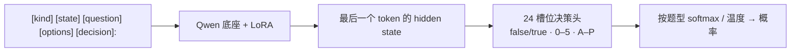

[**🇨🇳中文**](README.md) | [**🌐English**](README_EN.md) | [**📖文档**](docs/) | [**🤖模型**](https://huggingface.co/shibing624/train-jev-27b-lora)

# train-jev

自己训练、自己部署的 JEV 式决策模型：一次前向，给出校准过的概率。

[](https://huggingface.co/shibing624/train-jev-27b-lora)
[](https://github.com/shibing624/train-jev/actions/workflows/ci.yml)
[](LICENSE)
[](requirements.txt)
[](https://github.com/shibing624/train-jev/issues)

**train-jev** 开源复现了 JEV（TypeSafe Jev v1.13）的 System 1 决策模型配方：
在 Qwen3.5 / Qwen3.8 底座上训练 **LoRA + 24 槽位决策头**，用 KL 蒸馏 Jev v1.13 的完整输出分布。
模型不生成文本，而是在一次前向里直接给出每个选项的**概率**，可以直接拿来当置信度：
有把握的交给程序自动处理，没把握的转给人。

服务接口兼容 TypeSafe [System One API](https://docs.typesafe.ai/api)（`POST /v1/systemone`），
已经在调用 Jev 的代码只要换个地址就能接上。

## 特性

- **三种决策题型，一个请求问完**：是非题（`noul`）、选择题（`choice`）、打分题（`score`）共享同一段文本，各题独立作答、互不可见。
- **概率默认已校准**：每个模型都带按题型拟合的温度，返回的概率可以直接设阈值。
- **开箱即用的权重**：4B 和 27B 两个 LoRA 模型已发布在 Hugging Face，一行命令启动服务。
- **27B 追平官方 TypeSafe Jev，而且校准更好**：同题评测下准确率持平，ECE 从 0.097 降到 0.053。
- **能看图**：只用文本训练，底座的视觉编码器保持不变，训完的模型可以零样本对图像做决策。
- **训练模型，服务部署**：单文件训练脚本，多卡 DDP / FSDP2，支持断点续训；换个 `--base` 就能换底座。

## 模型

| 模型 | 底座 | 可训练参数 | 推理显存 | 下载 |
|---|---|---:|---|---|
| **shibing624/train-jev-4b-lora**（Ours） | Qwen3.5-4B | LoRA 30.5M + 决策头 61k | 24 GB | [🤗 HF](https://huggingface.co/shibing624/train-jev-4b-lora) |
| **shibing624/train-jev-27b-lora**（Ours） | Qwen3.8-27B | LoRA 108.8M + 决策头 123k | 80 GB | [🤗 HF](https://huggingface.co/shibing624/train-jev-27b-lora) |

## 效果

所有模型都在**同一批题**上评测。↑ 越高越好，↓ 越低越好。

| 评测 | train-jev-4b-lora<br>（Ours） | train-jev-27b-lora<br>（Ours） | Kev-4B | autotrust/JEV-27B-VL | TypeSafe Jev v1.13<br>（官方 API） |
|---|---:|---:|---:|---:|---:|
| **13 数据集分类 PK**（1,300 题） | | | | | |
| 准确率 ↑ | 0.647 | 0.678 | 0.640 | 0.690 | **0.700** |
| ECE ↓ | **0.076** | 0.103 | 0.083 | 0.094 | 0.130 |
| Kev 没见过的 8 个来源，准确率 ↑ | 0.603 | 0.630 | 0.570 | **0.645** | **0.645** |
| **Kev transfer-v4**（656 题，训练时没见过的来源） | | | | | |
| 准确率 ↑ | 0.779 | 0.851 | 0.817 | 0.852 | **0.857** |
| ECE ↓ | 0.075 | 0.053 | **0.042** | 0.097 | – |
| NLL ↓ | 0.745 | **0.411** | 0.435 | 0.460 | – |
| **Decision Index 0.3**（35 个基准，6,000 题） ↑ | 40.4 | 54.6 | 38.4 | 54.1 | **59.7** |
| **蒸馏保真度**（jev-distill） | | | | | |
| 分布内 KL ↓ | 0.022 | **0.019** | 0.387 | 0.021 | – |
| 分布外 KL ↓ | 0.311 | 0.110 | 0.624 | **0.108** | – |
| **零样本看图决策**（5 个视觉集） ↑ | 0.697 | 0.760 | 不支持 | **0.782** | – |
| 单请求延迟 p50 | 43 ms | 82 ms | **17 ms** | 96 ms | 370 ms（含网络） |

- **train-jev-27b-lora 和 autotrust/JEV-27B-VL 的准确率持平**（transfer-v4 0.851 对 0.852，Decision Index 54.6 对 54.1），
  **校准明显更好**：ECE 0.053 对 0.097，NLL 0.411 对 0.460。
- **train-jev-4b-lora 在同尺寸里领先 Kev-4B**：PK 准确率 0.647 对 0.640，Kev 没见过的来源上 0.603 对 0.570，
  Decision Index 40.4 对 38.4；PK 的 ECE 0.076 是所有模型里最低的。
- 差距：TypeSafe Jev v1.13 官方 API 在 PK 和 Decision Index 上仍然最好。

评测口径、逐项明细和更多对比见 [docs/results.md](docs/results.md)。

## 快速开始

### 安装

```bash
git clone https://github.com/shibing624/train-jev.git && cd train-jev
pip install -r requirements.txt
```

### 启动服务

```bash
python -m trainjev.serve --base Qwen/Qwen3.5-4B --adapter shibing624/train-jev-4b-lora --port 8020
```

首次运行会自动下载底座、LoRA、决策头和温度。换成 27B：
`--base Qwen/Qwen3.8-27B --adapter shibing624/train-jev-27b-lora`。

### 发一个请求

```bash
curl -s localhost:8020/v1/systemone -H 'content-type: application/json' -d '{
  "state": "快递晚到了两周，鞋码还发错了。另外我的卡上被扣了两次款。",
  "questions": {
    "department":  {"type": "choice", "instructions": "这条工单应该交给哪个团队？",
                    "criteria": {"售后": "换货、退款、发错或损坏的商品",
                                 "物流": "配送状态、延误、丢件",
                                 "财务": "扣款、发票、支付问题"}},
    "escalate":    {"type": "noul",  "instructions": "是否需要人工紧急介入？"},
    "frustration": {"type": "score", "instructions": "客户的不满程度？",
                    "criteria": ["平静", "不满", "非常愤怒"]}
  }}'
```

train-jev-4b-lora 的实际返回（概率保留两位小数）：

```json
{
  "answers": {
    "department":  {"type": "choice", "choice": "售后",
                    "probabilities": {"售后": 0.59, "物流": 0.21, "财务": 0.20}},
    "escalate":    {"type": "noul", "noul": 0.74},
    "frustration": {"type": "score", "score": 1.43,
                    "probabilities": {"0": 0.00, "1": 0.57, "2": 0.43}}
  }
}
```

这张工单同时涉及发错货、物流延误和重复扣款，所以 `department` 没有给出一边倒的答案。
这正是返回概率而不是单个标签的意义：你的代码可以只自动处理高置信度的情况，其余的交给人工。

### 在 Python 里调用

```python
import httpx

resp = httpx.post("http://127.0.0.1:8020/v1/systemone", json={
    "state": "I was charged twice. Please fix this ASAP.",
    "questions": {
        "billing": {"type": "noul", "instructions": "Is this ticket about billing?"},
        "tone": {"type": "choice", "instructions": "What is the customer's tone?",
                 "criteria": {"calm": None, "frustrated": None, "angry": None}},
    },
}, timeout=60).json()

if resp["answers"]["billing"]["noul"] > 0.9:
    print("route to billing:", resp["answers"]["tone"]["choice"])
```

更多示例见 [examples/](examples/) 和 [部署与推理文档](docs/serving.md)。

## 用自己的数据训练

训练数据是 jsonl，每行一道带目标分布的题：

```json
{"kind": "choice", "state": "...", "question": "Which team should handle this?",
 "options": ["billing", "infra", "product"], "target": [0.05, 0.90, 0.05], "weight": 1.0}
```

```bash
bash scripts/prepare_data.sh                       # 下载 jev-distill 语料和 Qwen3.5-4B 底座
GPUS=0,1,2 bash scripts/run_train.sh               # 4B：3 张 H20 约 2.8 小时
GPUS=0,1,2,3 bash scripts/run_train_27b.sh         # 27B：4 张 H20 约 33 小时
```

用 `--mix mydata.jsonl:2` 把自己的数据混进去。训练配方、断点续训、温度校准和显存估算见 [docs/training.md](docs/training.md)。

## 工作原理



决策头的 24 行从底座 `lm_head` 里对应 token（`false/true`、`0–5`、`A–P`）的行初始化，所以训练开始时模型的输出就等于底座本身的判断，
训练只是在此基础上把判断"磨锋利"。损失是对教师分布的 KL，打分题再加 0.5 倍的 RPS 序数损失；
训练时随机打乱 30% 选择题的选项，让模型按内容而不是位置作答。详见 [docs/training.md](docs/training.md)。

## 文档

| 文档 | 内容 |
|---|---|
| [docs/serving.md](docs/serving.md) | 部署与推理：服务参数、API 格式、示例、超过 16 个选项的读法 |
| [docs/training.md](docs/training.md) | 训练配方、数据格式、断点续训、温度校准、显存与速度、换底座 |
| [docs/evaluation.md](docs/evaluation.md) | 五套评测怎么跑、怎么复现 |
| [docs/results.md](docs/results.md) | 全部评测结果、逐项明细和局限 |

## Roadmap

- [x] Qwen3.5-4B / Qwen3.8-27B LoRA 训练、评测并发布到 Hugging Face
- [ ] 加入更广的公开金标数据，补齐知识推理和语言理解上和 TypeSafe Jev v1.13 的差距
- [ ] 训练 Full-finetune 的 Qwen3.8-27B
- [ ] `/v1/systemone` 服务支持图像输入

## Citation

```bibtex
@misc{train-jev,
  title={train-jev: Training JEV-style Decision Models},
  author={Ming Xu},
  year={2026},
  howpublished={\url{https://github.com/shibing624/train-jev}}
}
```

## Contact

- Issue：[](https://github.com/shibing624/train-jev/issues)
- 邮件：xuming624@qq.com

欢迎贡献，流程见 [CONTRIBUTING.md](CONTRIBUTING.md)。

## 致谢

- [autotrust/JEV-27B-VL](https://huggingface.co/autotrust/JEV-27B-VL) 公开配方，
- [SargeDev/jev-distill-corpus-v3](https://huggingface.co/datasets/SargeDev/jev-distill-corpus-v3) 提供训练语料，
- [jaredpalmer/kev](https://github.com/jaredpalmer/kev) 的评测集和对照模型，
- [Decision Index](https://github.com/apolinario/decision-index)，以及 [Qwen](https://huggingface.co/Qwen) 底座。

本项目是独立的算法研究复现，与 TypeSafe AI、autotrust 均无关联。

## License

代码采用 [Apache-2.0](LICENSE)。Qwen 底座同为 Apache-2.0；训练和评测数据遵循各自的许可。
