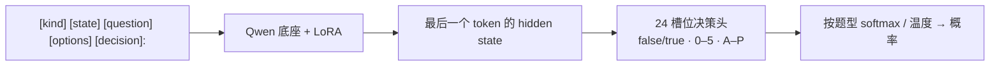

[**🇨🇳中文**](README.md) | [**🌐English**](README_EN.md) | [**📖文档**](docs/) | [**🤖模型**](https://huggingface.co/shibing624/train-jev-27b-lora)

# train-jev

自己训练、自己部署的 JEV 式决策模型：一次前向，给出校准过的概率。

[](https://huggingface.co/shibing624/train-jev-27b-lora)
[](https://github.com/shibing624/train-jev/actions/workflows/ci.yml)
[](LICENSE)
[](requirements.txt)
[](https://github.com/shibing624/train-jev/issues)

**train-jev** 提供 JEV 式 System 1 决策模型的训练、评测和部署代码，以及开箱即用的 **4B / 27B LoRA 权重**。
在 Qwen3.5 / Qwen3.8 底座上训练 **LoRA + 24 槽位决策头**，先学习 Jev v1.13 的输出分布，再用公开金标和规则数据增强判断能力。
模型不生成文本，而是直接返回每个选项的**概率**：让代码自动处理高置信度的判断，其余交给人工。

服务接口兼容 TypeSafe [System One API](https://docs.typesafe.ai/api)（`POST /v1/systemone`），已经在调用 Jev 的代码只要换个地址就能接上。

## 特性

- **三种决策题型，一个请求问完**：是非题（`noul`）、选择题（`choice`）、打分题（`score`）共享同一段文本，各题独立作答。
- **概率默认已校准**：模型附带按题型拟合的温度，便于设置自动处理与人工复核的阈值；新领域可重新校准。
- **开箱即用**：4B 和 27B 两个 LoRA 模型已发布在 Hugging Face，一行命令启动服务。
- **决策能力持续提升**：27B 在 train-jev-pk 上达到 79.52% 宏平均准确率，公开 Decision Index 全量得分 57.01；4B 分别为 76.03% 和 42.00。
- **能看图**：`trainjev.serve --vision` 支持 TypeSafe 风格的图片 `assets`，可用 JSON/base64 或 multipart 上传，在同一个 `/v1/systemone` 请求里问是非、选择和打分题；见[图片接口](docs/serving.md#图片输入typesafe-assets)。
- **可复用的训练方法**：KL 蒸馏、金标监督、规则数据回放、多卡 DDP / FSDP2 和断点续训，支持混入自己的标注数据。

## 模型

| 模型 | 底座 | 可训练参数 | 推理显存 | 下载 |
|---|---|---:|---|---|
| **shibing624/train-jev-4b-lora**（Ours） | Qwen3.5-4B | LoRA 30.5M + 决策头 61k | 24 GB | [🤗 HF](https://huggingface.co/shibing624/train-jev-4b-lora) |
| **shibing624/train-jev-27b-lora**（Ours） | Qwen3.8-27B | LoRA 108.8M + 决策头 123k | 80 GB | [🤗 HF](https://huggingface.co/shibing624/train-jev-27b-lora) |

## 效果

Ours 为当前发布模型；Kev、autotrust 和官方 API 列是历史参照，未随本轮重新运行。↑ 越高越好，↓ 越低越好。

| 评测 | train-jev-4b-lora<br>（Ours） | train-jev-27b-lora<br>（Ours） | Kev-4B | autotrust/JEV-27B-VL | TypeSafe Jev v1.13<br>（官方 API） |
|---|---:|---:|---:|---:|---:|
| **[train-jev-pk](data/train-jev-pk/)**（2,494 题，22 个任务） | | | | | |
| 任务宏平均准确率 ↑ | 76.03% | **79.52%** | 63.50% | 73.47% | – |
| ECE ↓ | 0.0930 | **0.0901** | 0.159 | 0.107 | – |
| **[train-jev-classification-pk](data/train-jev-classification-pk/)**（13 个场景，1,300 题） | | | | | |
| 准确率 ↑ | 0.6523 | 0.6938 | 0.640 | 0.690 | **0.700** |
| ECE ↓ | 0.0622 | **0.0377** | 0.083 | 0.094 | 0.130 |
| **[Kev transfer-v4](https://github.com/jaredpalmer/kev)**（656 题，训练时没见过的来源） | | | | | |
| 准确率 ↑ | 0.8201 | 0.8476 | 0.817 | 0.852 | **0.857** |
| ECE ↓ | 0.0588 | 0.0681 | **0.042** | 0.097 | – |
| **[Decision Index 0.3，采样得分](https://github.com/apolinario/decision-index)（6,000 请求）** ↑ | 43.84 | 57.54 | 38.4 | 54.1 | **59.7** |
| **[Decision Index 0.3，全量得分](https://github.com/apolinario/decision-index)（110,087 请求）** ↑ | 42.00 | **57.01** | – | – | – |

- **两尺寸的综合决策能力提高**：相比上一发布的存档结果，DI 全量得分 4B 39.01 → 42.00、27B 55.58 → 57.01；train-jev-pk 准确率分别为 76.03% / 79.52%。
- **提升不是全面的**：27B transfer-v4 准确率 85.82% → 84.76%，ECE 0.0316 → 0.0681；4B 的分类和 transfer ECE 也变差。按自己的任务选模型，不把综合分提升当成所有任务都更好。
- **方法可迁移到自己的业务**：小规模 LoRA + 决策头，结合软分布蒸馏、金标和规则监督，提供从训练到校准、评测、服务的完整链路。

> Decision Index 是综合得分，不是准确率；公开 37 个计分基准的请求全部完成，但六个非计分诊断未请求，不等于完整私有榜单。旧结果来自原始存档与 CPU 复算；旧分类宽选项用 tournament，新模型用 single，不能把全部差异归因于权重。新版视觉没有重测，图像接口支持不代表视觉质量已重新验证。数据与来源限制见 [data/](data/) 和 [结果文档](docs/results.md)。

## 快速开始

```bash
git clone https://github.com/shibing624/train-jev.git && cd train-jev
pip install -r requirements.txt
python -m trainjev.serve --base Qwen/Qwen3.5-4B --adapter shibing624/train-jev-4b-lora --port 8020
```

首次运行会自动下载底座、LoRA、决策头和温度。换成 27B：
`--base Qwen/Qwen3.8-27B --adapter shibing624/train-jev-27b-lora`。

### 发一个请求

```bash
curl -s localhost:8020/v1/systemone -H 'content-type: application/json' -d '{
  "state": "快递晚到了两周，鞋码还发错了。另外我的卡上被扣了两次款。",
  "questions": {
    "department": {"type": "choice", "instructions": "这条工单应该交给哪个团队？",
                   "criteria": {"售后": "换货、退款、发错或损坏的商品",
                                "物流": "配送状态、延误、丢件",
                                "财务": "扣款、发票、支付问题"}},
    "escalate":   {"type": "noul", "instructions": "是否需要人工紧急介入？"}
  }}'
```

返回每个团队的概率及需要人工介入的概率，不只返回一个标签。更多示例见 [examples/](examples/) 和 [部署与推理文档](docs/serving.md)。

## 训练数据与复刻

4B 和 27B 使用同一套数据与训练方法：先做软分布蒸馏，再混入公开金标和独立校验的规则样本。

| 训练数据 | 用途 | 处理后的训练行数 |
|---|---|---:|
| [SargeDev/jev-distill-corpus-v3](https://huggingface.co/datasets/SargeDev/jev-distill-corpus-v3) | 基础蒸馏与旧数据回放，覆盖 `choice` / `noul` / `score` | 655,806 |
| [GSM8K](https://huggingface.co/datasets/openai/gsm8k) | 数学选择题，两种干扰项构造 | 11,148 |
| [PAWS](https://huggingface.co/datasets/google-research-datasets/paws)、[AQuA-RAT](https://huggingface.co/datasets/deepmind/aqua_rat)、[QASC](https://huggingface.co/datasets/allenai/qasc)、[HelpSteer2](https://huggingface.co/datasets/nvidia/HelpSteer2) | 释义判断、数学与科学选择题、正确性评分 | 15,999 |
| 独立校验的规则样本（CC0） | 路由、证据、指代、退款换算、日历和条件计数 | 10,000 |

当前发布在原有蒸馏、金标和规则基础上，进一步使用 [tasksource typed-decisions](https://huggingface.co/datasets/tasksource/tasksource-jev-typed-decisions) 的 12,947 行任务来源数据，覆盖常识、阅读、投票软标签、实体和法律任务。各阶段采样不同，不能把旧的 12.5% 配方当成当前全部训练过程；实际曝光和参数见模型包的 `training_recipe.json`。本轮发布沿用各自原有校准，不在新评测上重拟合。

```bash
# 基础蒸馏：下载数据与底座，启动训练
bash scripts/prepare_data.sh
GPUS=0,1,2 bash scripts/run_train.sh

# 27B 基础蒸馏
BASE_REPO=Qwen/Qwen3.8-27B BASE_DIR=models/Qwen3.8-27B bash scripts/prepare_data.sh
GPUS=0,1,2,3 bash scripts/run_train_27b.sh
```

上述脚本从 Qwen 底座做基础蒸馏，再混入公开金标或自己的 JSONL 数据即可训练业务模型。完整流程、可运行的 PAWS 转换示例、续训和校准见 [训练文档](docs/training.md)。发布模型使用更完整的金标与规则组合，具体设置见 HF 模型包的 `training_recipe.json`。

用自己的数据时，转成 JSONL，每行一道带目标分布的题，再通过 `--mix mydata.jsonl:2` 混入：

```json
{"kind": "choice", "state": "...", "question": "Which team should handle this?", "options": ["billing", "infra", "product"], "target": [0.05, 0.90, 0.05], "weight": 1.0}
```

## 工作原理



决策头从底座 `lm_head` 的对应 token 行初始化，保留底座已有判断能力；基础损失是教师分布的 KL，打分题再加 RPS 序数损失，选择题随机置换选项以减少位置偏好。详见 [训练文档](docs/training.md)。

## 文档

| 文档 | 内容 |
|---|---|
| [部署与推理](docs/serving.md) | 服务参数、API、示例、宽选项 |
| [训练](docs/training.md) | 数据与配方、续训、校准、显存与速度、换底座 |
| [评测](docs/evaluation.md) | 各套评测的运行与复现 |
| [结果](docs/results.md) | 评测明细、对照与局限 |

## Roadmap

- [x] Qwen3.5-4B / Qwen3.8-27B LoRA 训练、评测并发布到 Hugging Face
- [x] 加入公开金标和规则数据，27B 在 train-jev-pk 上超过 autotrust/JEV-27B-VL
- [ ] 更广的公开金标数据，补齐知识推理和语言理解上与 TypeSafe Jev v1.13 的差距
- [ ] 训练 Full-finetune 的 Qwen3.8-27B
- [x] `/v1/systemone` 服务支持 TypeSafe 图片 assets（JSON/base64、multipart）

## Citation

```bibtex
@misc{train-jev,
  title={train-jev: Training JEV-style Decision Models},
  author={Ming Xu},
  year={2026},
  howpublished={\url{https://github.com/shibing624/train-jev}}
}
```

## Contact

- GitHub Issue：[](https://github.com/shibing624/train-jev/issues)
- 邮件：xuming624@qq.com
- 微信群：添加微信号 `xuming624`，备注 "llm"，加入技术交流群


欢迎贡献，流程见 [CONTRIBUTING.md](CONTRIBUTING.md)。

## 致谢

- [autotrust/JEV-27B-VL](https://huggingface.co/autotrust/JEV-27B-VL) 公开模型权重，
- [SargeDev/jev-distill-corpus-v3](https://huggingface.co/datasets/SargeDev/jev-distill-corpus-v3) 提供训练语料，
- [jaredpalmer/kev](https://github.com/jaredpalmer/kev) 的评测集和对照模型，
- [Decision Index](https://github.com/apolinario/decision-index)，以及 [Qwen](https://huggingface.co/Qwen) 底座。

本项目是独立的算法研究复现，与 TypeSafe AI、autotrust 均无关联。

## License

代码采用 [Apache-2.0](LICENSE)。Qwen 底座同为 Apache-2.0；训练和评测数据遵循各自的许可。
