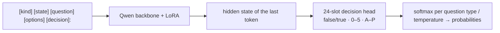

[**🇨🇳中文**](README.md) | [**🌐English**](README_EN.md) | [**📖Docs**](docs/) | [**🤖Models**](https://huggingface.co/shibing624/train-jev-27b-lora)

# train-jev

JEV-style decision models you can train and run yourself: calibrated probabilities in one forward pass.

[](https://huggingface.co/shibing624/train-jev-27b-lora)
[](https://github.com/shibing624/train-jev/actions/workflows/ci.yml)
[](LICENSE)
[](requirements.txt)
[](https://github.com/shibing624/train-jev/issues)

**train-jev** provides training, evaluation and serving code for JEV-style System 1 decision models, with ready-to-use **4B / 27B LoRA weights**.
A **LoRA + 24-slot decision head** on Qwen3.5 / Qwen3.8 first learns Jev v1.13 output distributions, then improves its decisions with public gold labels and rule data.
The model does not generate text. It returns a **probability for every option**: let your code handle confident decisions and route the rest to a person.

The server speaks TypeSafe's [System One API](https://docs.typesafe.ai/api) (`POST /v1/systemone`), so code that already calls Jev only needs a new URL.

## Highlights

- **Three question types in one request**: yes/no (`noul`), multiple choice (`choice`) and rating (`score`), answered independently over shared text.
- **Calibrated by default**: per-type temperatures help set thresholds for automation and human review; recalibrate for new domains when needed.
- **Ready to run**: both 4B and 27B LoRA models are on Hugging Face, with one-command serving.
- **Improved decision capability**: 27B reaches 79.52% task-macro accuracy on train-jev-pk and 57.01 on the full public Decision Index; 4B reaches 76.03% and 42.00.
- **Vision capability**: `trainjev.serve --vision` accepts TypeSafe-style image `assets` via JSON/base64 or multipart, with yes/no, choice and score questions on the same `/v1/systemone` endpoint; see [image requests](docs/serving.en.md#image-input-typesafe-assets).
- **Reusable training method**: KL distillation, gold supervision, rule-data replay, multi-GPU DDP / FSDP2, resumable runs and custom-data mixtures.

## Models

| Model | Backbone | Trainable parameters | GPU for inference | Download |
|---|---|---:|---|---|
| **shibing624/train-jev-4b-lora** (Ours) | Qwen3.5-4B | LoRA 30.5M + head 61k | 24 GB | [🤗 HF](https://huggingface.co/shibing624/train-jev-4b-lora) |
| **shibing624/train-jev-27b-lora** (Ours) | Qwen3.8-27B | LoRA 108.8M + head 123k | 80 GB | [🤗 HF](https://huggingface.co/shibing624/train-jev-27b-lora) |

## Results

Ours denotes the current release. Kev, autotrust and official API columns are historical references, not rerun in this round. ↑ higher is better, ↓ lower is better.

| Evaluation | train-jev-4b-lora<br>(Ours) | train-jev-27b-lora<br>(Ours) | Kev-4B | autotrust/JEV-27B-VL | TypeSafe Jev v1.13<br>(official API) |
|---|---:|---:|---:|---:|---:|
| **[train-jev-pk](data/train-jev-pk/)** (2,494 questions, 22 tasks) | | | | | |
| Task-macro accuracy ↑ | 76.03% | **79.52%** | 63.50% | 73.47% | – |
| ECE ↓ | 0.0930 | **0.0901** | 0.159 | 0.107 | – |
| **[train-jev-classification-pk](data/train-jev-classification-pk/)** (13 scenarios, 1,300 questions) | | | | | |
| Accuracy ↑ | 0.6523 | 0.6938 | 0.640 | 0.690 | **0.700** |
| ECE ↓ | 0.0622 | **0.0377** | 0.083 | 0.094 | 0.130 |
| **[Kev transfer-v4](https://github.com/jaredpalmer/kev)** (656 questions from unseen sources) | | | | | |
| Accuracy ↑ | 0.8201 | 0.8476 | 0.817 | 0.852 | **0.857** |
| ECE ↓ | 0.0588 | 0.0681 | **0.042** | 0.097 | – |
| **[Decision Index 0.3, sampled score](https://github.com/apolinario/decision-index) (6,000 requests)** ↑ | 43.84 | 57.54 | 38.4 | 54.1 | **59.7** |
| **[Decision Index 0.3, full-panel score](https://github.com/apolinario/decision-index) (110,087 requests)** ↑ | 42.00 | **57.01** | – | – | – |

- **Aggregate decision scores improve for both sizes**: against original archived results, full DI rises from 39.01 to 42.00 for 4B and 55.58 to 57.01 for 27B; train-jev-pk accuracy is 76.03% / 79.52%.
- **Gains are not universal**: 27B transfer-v4 accuracy falls from 85.82% to 84.76%, with ECE rising from 0.0316 to 0.0681; 4B classification and transfer ECE also worsen. Choose for your workload rather than assuming every task improves.
- **Adapt the method to your workload**: compact LoRA + head training combines soft-distribution distillation, gold labels and rules, with an end-to-end path through calibration, evaluation and serving.

> Decision Index is a composite score, not accuracy. All requested 37 public scoring benchmarks are complete, but six unindexed diagnostics were not requested; this is not the private Full leaderboard. Old results are original archives/CPU recompositions. Old classification wide choices used tournament and new models use single, so not all differences are weight effects. New vision quality was not re-evaluated. Data and provenance limitations are in [data/](data/) and [the results guide](docs/results.en.md).

## Quick Start

```bash
git clone https://github.com/shibing624/train-jev.git && cd train-jev
pip install -r requirements.txt
python -m trainjev.serve --base Qwen/Qwen3.5-4B --adapter shibing624/train-jev-4b-lora --port 8020
```

The first run downloads the backbone, LoRA, decision head and temperatures. For 27B, use
`--base Qwen/Qwen3.8-27B --adapter shibing624/train-jev-27b-lora`.

### Send a request

```bash
curl -s localhost:8020/v1/systemone -H 'content-type: application/json' -d '{
  "state": "Shoes arrived two weeks late and in the wrong size. Also I see two charges on my card.",
  "questions": {
    "department": {"type": "choice", "instructions": "Which team should handle this?",
                   "criteria": {"returns": "Exchanges, refunds, wrong or damaged items",
                                "shipping": "Delivery status, delays, lost packages",
                                "billing": "Charges, invoices, payment problems"}},
    "escalate":   {"type": "noul", "instructions": "Does this need urgent human attention?"}
  }}'
```

The response includes probabilities for each team and for human escalation, not just a label. See [examples/](examples/) and [the serving guide](docs/serving.en.md).

## Training Data and Reproduction

Both sizes use the same data and method: soft-distribution distillation followed by public gold supervision and independently verified rule examples.

| Training data | Purpose | Processed training rows |
|---|---|---:|
| [SargeDev/jev-distill-corpus-v3](https://huggingface.co/datasets/SargeDev/jev-distill-corpus-v3) | Initial distillation and replay across `choice` / `noul` / `score` | 655,806 |
| [GSM8K](https://huggingface.co/datasets/openai/gsm8k) | Mathematics choice questions with two distractor constructions | 11,148 |
| [PAWS](https://huggingface.co/datasets/google-research-datasets/paws), [AQuA-RAT](https://huggingface.co/datasets/deepmind/aqua_rat), [QASC](https://huggingface.co/datasets/allenai/qasc), [HelpSteer2](https://huggingface.co/datasets/nvidia/HelpSteer2) | Paraphrases, mathematics/science choices and correctness ratings | 15,999 |
| Independently verified rules (CC0) | Routing, evidence, coreference, refund conversion, calendars and condition counting | 10,000 |

The current release further uses 12,947 admitted rows from [tasksource typed-decisions](https://huggingface.co/datasets/tasksource/tasksource-jev-typed-decisions), spanning commonsense, reading, soft vote labels, entities and legal tasks, on top of distillation, gold labels and rules. Sampling differs by phase; the old 12.5% recipe does not describe the whole current run. Actual exposures and settings are in `training_recipe.json`. This publication retains each model's existing calibration rather than refitting on the new evaluations.

```bash
# Initial distillation: download data and backbone, then train
bash scripts/prepare_data.sh
GPUS=0,1,2 bash scripts/run_train.sh

# Initial distillation for 27B
BASE_REPO=Qwen/Qwen3.8-27B BASE_DIR=models/Qwen3.8-27B bash scripts/prepare_data.sh
GPUS=0,1,2,3 bash scripts/run_train_27b.sh
```

These scripts distill from the Qwen backbone; mix public gold or your own JSONL data to refine a business model. The [training guide](docs/training.en.md) provides the full workflow, a runnable PAWS conversion example, refinement and calibration. Published models use a broader gold-and-rule mixture; settings are in the HF package's `training_recipe.json`.

For custom data, prepare JSONL with one question and target distribution per line, then mix it in with `--mix mydata.jsonl:2`:

```json
{"kind": "choice", "state": "...", "question": "Which team should handle this?", "options": ["billing", "infra", "product"], "target": [0.05, 0.90, 0.05], "weight": 1.0}
```

## How It Works



The head is initialized from the corresponding backbone `lm_head` token rows, preserving the backbone's starting judgments. Initial training uses KL to teacher distributions, an ordinal RPS loss for ratings and shuffled choice options to reduce position bias. Details are in [the training guide](docs/training.en.md).

## Documentation

| Document | Contents |
|---|---|
| [Serving](docs/serving.en.md) | Server flags, API, examples and wide choices |
| [Training](docs/training.en.md) | Data, recipes, resuming, calibration, memory, speed and backbones |
| [Evaluation](docs/evaluation.en.md) | Running and reproducing the evaluation suites |
| [Results](docs/results.en.md) | Breakdowns, comparisons and limitations |

## Roadmap

- [x] Train, evaluate and release Qwen3.5-4B / Qwen3.8-27B LoRA models on Hugging Face
- [x] Add public gold and rule data; 27B beats autotrust/JEV-27B-VL on train-jev-pk
- [ ] Broader public gold-labelled data to close the knowledge and language gaps to TypeSafe Jev v1.13
- [ ] Full fine-tune of Qwen3.8-27B
- [x] TypeSafe image assets in `/v1/systemone` (JSON/base64 and multipart)

## Citation

```bibtex
@misc{train-jev,
  title={train-jev: Training JEV-style Decision Models},
  author={Ming Xu},
  year={2026},
  howpublished={\url{https://github.com/shibing624/train-jev}}
}
```

## Contact

- Issues: [](https://github.com/shibing624/train-jev/issues)
- Email: xuming624@qq.com
- WeChat group: add `xuming624` with the note "llm"


Contributions are welcome; see [CONTRIBUTING.md](CONTRIBUTING.md).

## Acknowledgements

- [autotrust/JEV-27B-VL](https://huggingface.co/autotrust/JEV-27B-VL) for the public model weights,
- [SargeDev/jev-distill-corpus-v3](https://huggingface.co/datasets/SargeDev/jev-distill-corpus-v3) for the training corpus,
- [jaredpalmer/kev](https://github.com/jaredpalmer/kev) for evaluation suites and reference models,
- [Decision Index](https://github.com/apolinario/decision-index), and [Qwen](https://huggingface.co/Qwen) for the backbones.

This is an independent research reproduction, not affiliated with TypeSafe AI or autotrust.

## License

Code: [Apache-2.0](LICENSE). The Qwen backbones are also Apache-2.0; training and evaluation data keep their own licenses.
