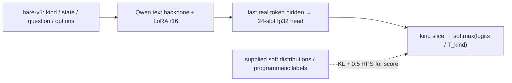

[中文](README.md) | [English](README_EN.md) | [Training](docs/training.md) | [Results](docs/results.md)

# train-jev: Training JEV-style Decision Models

[](https://huggingface.co/shibing624)
[](LICENSE)
[](requirements.txt)

**train-jev** is an open-source System 1 typed-decision training and inference framework. It implements the public
JEV-style recipe: **LoRA + a 24-slot fp32 decision head** on a Qwen text backbone, trained against supplied target
distributions using KL and ordinal RPS. It does not generate answer text to make a decision.
This is an independent reproduction, not affiliated with TypeSafe AI or autotrust.

**Both 4B and 27B LoRA runs completed 5,123 steps, checkpoint validation and five evaluation suites.** This repository
includes reproducible inputs/settings, training/resume/calibration commands, inference demos, reports and HF release
preparation. They are useful baselines; **no SOTA claim is made**.

## Models and release status

| model | backbone | trainable LoRA / head | best validation KL | status |
|---|---|---:|---:|---|
| train-jev 4B | `Qwen/Qwen3.5-4B` | 30.5M / 61,464 | 0.0160 | trained and evaluated |
| train-jev 27B r1 | `Qwen/Qwen3.8-27B` | 108.8M / 122,904 | 0.01423 | trained and evaluated |

HF models: [shibing624/train-jev-4b-lora](https://huggingface.co/shibing624/train-jev-4b-lora) and
[shibing624/train-jev-27b-lora](https://huggingface.co/shibing624/train-jev-27b-lora). Each holds a LoRA adapter, the
custom `head.pt` and calibration, without base weights; load them with this repository (see "Deployment").

## Interface

| type | example | output |
|---|---|---|
| `noul` | Is this order eligible under the refund rules? | P(true) |
| `choice` | Which team should handle it? | option probabilities and argmax |
| `score` | Severity from 0 to 5? | six-level probabilities and expected level |

Serving exposes **`POST /v1/systemone`** and `GET /health`. Multiple questions share a state but are inferred
independently; they do not see each other's answers. Per-kind temperatures are fitted on a separate calibration
split. These are probability estimates, **not a guarantee of calibration on every deployment domain**.
The local HTTP backend is text-only; zero-shot images use the separate `eval_vision` path.

## Method



- **Initialisation:** copy the `lm_head` rows of `false/true`, `0–5`, `A–P`; zero bias. `check_init.py` validates
  restricted next-token readout equality rather than starting from a random classifier.
- **LoRA:** rank 16, alpha 32, dropout 0.05 on DeltaNet `in_proj_qkv/in_proj_z/out_proj`, full-attention `q/k/v/o_proj`
  and MLP `gate/up/down_proj`. The backbone is frozen; LoRA and the decision head are trainable.
- **Objective:** per-row weighted KL(target || prediction), plus 0.5 RPS only for six-level score questions.
  Micro-batch sums are normalised by the global 128-row batch, not by micro-batch count or sum of weights.
- **Data:** 655,806 training rows: yuri_v3 443,977, openjev_v2 74,626, yuri_v1 137,203. Source buckets do not imply
  that every label comes from one API. The existing placeholder/uniform-pair heuristic reduces loss weight to 0.05.
- **Sampling:** take `floor(128/6)=21` rows per kind, then fill the rest from the whole pool, with step-seeded RNG.
  This resamples across steps; it is not a without-replacement traversal. 5,123 steps mean 655,744 presentations,
  approximately one epoch-equivalent draw budget, not a guarantee that every training row was seen.
- **Augmentation:** shuffle 30% of choice rows together with their targets. Choice training supports at most 16 options.
- **Optimisation:** AdamW beta=(0.9,0.98), zero weight decay, LoRA/head lr=1e-4/2e-4, 3% warmup, cosine to 0.02×,
  global norm clip 1. Every 500 steps evaluate a fixed 4,000-row validation subset and select minimum KL.
- **Calibration:** fit per-kind temperatures on calibration, excluding placeholders, never using test labels.

[Training details](docs/training.md) cover equations, prompts, right padding, token boundaries, DDP/FSDP2 and data
independence. Fixed inputs/seeds/settings make runs traceable; **bit-identical outputs across GPU counts, library
versions, BF16 merging and deployment implementations are not promised**.

## Completed results

Same evaluation rows. DI is the **old 6,000-request 35-benchmark recalculation, not the complete official index**.
The historical 4B/r1 wide readout is tournament; the original JEV reference uses single and a different backend.
This table does not isolate readout strategy or equal compute.

| metric | 4B LoRA | 27B LoRA r1 | original JEV-27B-VL |
|---|---:|---:|---:|
| test KL, 6,000 rows, calibrated ↓ | 0.02239 | **0.01853** | 0.02075 |
| OOD KL, 3,000 rows ↓ | 0.31073 | 0.11006 | **0.10842** |
| DI 35,6,000 requests ↑ | 40.35 | **54.57** | 54.11 |
| transfer-v4 accuracy, 656 rows ↑ | 77.90% | 85.06% | **85.21%** |
| transfer-v4 ECE ↓ | 0.07468 | **0.05308** | 0.09731 |
| transfer-v4 NLL ↓ | 0.74455 | **0.41130** | 0.46022 |
| PK accuracy, 1,300 rows ↑ | 64.69% | 67.77% | **69.00%** |
| PK ECE ↓ | **0.07569** | 0.10294 | 0.094 |
| vision mean skill, 5 sets equally weighted ↑ | 0.69729 | 0.75999 | **0.78195** |

27B improves substantially over our 4B baseline, but does not beat the original JEV on every metric. The +0.46 DI
margin has no paired significance/CI analysis. The 4B full-parameter run did not improve the overall result, so this
27B run used LoRA. Single-seed limits, shared in-distribution states, protocol and hardware differences are explicit
in [results §8/§10](docs/results.md). HLE/HoVer are not prerequisites for the completed old-protocol main result;
the complete 37 panel is a separately tracked branch.

## Installation and pinned inputs

```bash
git clone https://github.com/shibing624/train-jev
cd train-jev
pip install -r requirements.txt
```

Python >=3.12. Tested: Python 3.12.11, torch 2.13.0+cu129, transformers 5.17.0, peft 0.21.0, fla 0.5.2.
`requirements-tested.txt` records the reference environment; it is not a portable CUDA lock. Install matching
CUDA torch/torchvision wheels first. CI uses CPU packages. `causal-conv1d` was not used for the main result.

| input | pinned HF revision |
|---|---|
| `SargeDev/jev-distill-corpus-v3` | `75111a13a8455032f0435050bfc7e0c9026ecfe8` |
| `Qwen/Qwen3.5-4B` (post-trained, not -Base) | `851bf6e806efd8d0a36b00ddf55e13ccb7b8cd0a` |
| `Qwen/Qwen3.8-27B` | `1d4bf0f2ff6012fd82039f2fa52739d0dd7c60c0` |

```bash
bash scripts/prepare_data.sh
BASE_REPO=Qwen/Qwen3.8-27B BASE_DIR=models/Qwen3.8-27B bash scripts/prepare_data.sh
```

Explicit overrides: `HF_ENDPOINT`, `DATA_REVISION`, `BASE_REVISION`. Record the actual revision, not only a folder
name. Audit candidate training data with `scripts/audit_training_data.py`; do not recycle evaluation errors into training.

## Train, resume and calibrate

```bash
GPUS=0,1,2 SAVE_STATE_EVERY=100 bash scripts/run_train.sh
GPUS=0,1,2,3 SAVE_STATE_EVERY=100 bash scripts/run_train_27b.sh
# Stop early without changing the full learning-rate schedule.
GPUS=0 MAX_STEPS=3 OUT=runs/smoke bash scripts/run_train.sh
# Same output, topology and settings; restores optimizer and all rank RNG state.
GPUS=0,1,2,3 RESUME=1 OUT=runs/jev-27b bash scripts/run_train_27b.sh
CKPT=runs/jev-4b/best bash scripts/run_eval.sh
BASE=models/Qwen3.8-27B CKPT=runs/jev-27b/best OUT=eval/jev-27b bash scripts/run_eval.sh
```

Inference best/step bundles are not resumable training states. DCP state is in `state/`, with `state.old/` recovery
when appropriate. Missing `--resume` state fails rather than silently retraining. Logs append. Interval 100 leaves
state 5,100 after a 5,123-step run; final inference weights are step05123. A 4B 3+3 resume test matched uninterrupted 6-step
adapter/head tensors exactly. Read [the full resume contract](docs/training.md#resuming-long-runs).

| measured run | peak memory/GPU | time incl. periodic validation, not final evaluation |
|---|---:|---:|
| 4B, 3×H20,no_gc, micro_tokens4096 | ~48.8 GB | 2.77 h |
| 27B, 4×H20,GC, micro_tokens16384 | 74.9 GB | 33.07 h, 23.24 s/step |

Only the text model is trained. Image inference loads the full VL base and applies the text adapter. Generation
with the adapter enabled/merged was not separately evaluated; unchanged base files are not proof of unchanged generation.

## Serving and inference demos

```bash
BASE=models/Qwen3.5-4B CKPT=runs/jev-4b/best PORT=8020 STRATEGY=tournament bash scripts/run_serve.sh
python examples/client.py --url http://127.0.0.1:8020
python examples/batch_decisions.py --url http://127.0.0.1:8020
python examples/smoke_systemone.py --url http://127.0.0.1:8020
python examples/wide_choices.py --url http://127.0.0.1:8020 --compare
python examples/local_inference.py --base models/Qwen3.5-4B --adapter runs/jev-4b/best --device cuda
```

The 4B API demos were executed: 3/3 fixed qualitative smoke cases, valid noul/choice/score output shapes and
probability normalisation. These are usability checks, not a general accuracy estimate or latency benchmark.
After upload, HF adapters include their head and temperatures:

```bash
python -m trainjev.serve --base models/Qwen3.5-4B --adapter shibing624/train-jev-4b-lora \
  --adapter_revision v0.2.0 --port 8020 --strategy tournament
```

The model tag `v0.2.0` matches the code tag
[v0.2.0](https://github.com/shibing624/train-jev/tree/v0.2.0). Reproduce historical numbers with explicit tournament;
default single is a different protocol.

### Wide choices

A–P are the only trained head labels. Single/permute use untrained base lm_head rows for extra options, zero bias.
Suitable token labels establish computability, not validated wide-choice quality.

| strategy | accuracy (1,800) | ECE ↓ | p50 |
|---|---:|---:|---:|
| single (default) | 72.67% | 0.1622 | 52.3 ms |
| tournament | 73.22% | **0.0499** | 108.9 ms |
| permute | **77.11%** | 0.2180 | 171.2 ms |

Same 4B checkpoint, 600 each CLINC150/BANKING77/MASSIVE en. Permute improves accuracy but is underconfident;
tournament is 6pp worse than single on MASSIVE en. The default remains unchanged pending independent-dev selection
and calibration. Do not fit on these test labels. [Paired results and trace limits](docs/results.md#7-wide-choice-questions-17256-options).

## Next 4B/27B TODO

- [x] 4B LoRA/full comparison, complete 27B training and five old-protocol evaluations; public code/reports.
- [x] Same 4B checkpoint wide-strategy comparison, 600 rows/scenario, accuracy/calibration/latency recorded.
- [x] Audit tooling, optimizer/RNG resume, HF checkpoint loading and inference demos; actual HF upload remains separate.
- [ ] Select wide strategy/post-average temperature on independent dev, then check a separate final test.
- [ ] 4B-v2: verify gold provenance/revision/split/licence and semantic quality; add knowledge/reasoning/language
      coverage with state/source-group/counterfactual-group isolation, not recycled evaluation questions.
- [ ] Fixed control and full LR schedule; isolate actual gold dose, target softening and 2/4/8/16-option coverage.
      Keep step/batch/micro-token budgets and report actual tokens/padding, not merely a shared upper bound.
- [ ] Once data is fixed, compare LoRA r32/r64 or full fine-tuning; full is a candidate, not a predetermined winner.
      Short probes use `STEPS=5123 MAX_STEPS=400`, not a400-step cosine schedule.
- [ ] Complete and repeat promising 4B runs across seeds; pass independent dev/calibration/vision gates before 27B-v2.
      Compare against current r1 and the original JEV on identical inputs; SOTA requires broader supporting evidence.
- [ ] Complete 37 DI and vLLM numerical branches remain separate from the completed old 35 result.
- [x] Uploaded the 4B/27B HF adapters (tag `v0.2.0`, code revision `cb73b78`). 9B is planned, not trained.

## License, citation and contact

Code: [Apache-2.0](LICENSE). Base models and training/evaluation data retain their own terms.

```bibtex
@misc{train-jev,
  title={train-jev: Training JEV-style Decision Models},
  author={Ming Xu},
  year={2026},
  howpublished={\url{https://github.com/shibing624/train-jev}}
}
```

Ming Xu / shibing624. [Issues](https://github.com/shibing624/train-jev/issues), xuming624@qq.com.
Thanks to [JEV](https://huggingface.co/autotrust/JEV-27B-VL), SargeDev, Open-Jev,
[Kev](https://github.com/jaredpalmer/kev), [Decision Index](https://github.com/apolinario/decision-index), Qwen and fla.
Contribution workflow: [CONTRIBUTING.md](CONTRIBUTING.md).
