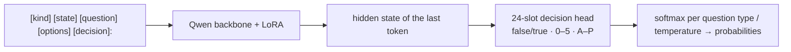

[**🇨🇳中文**](README.md) | [**🌐English**](README_EN.md) | [**📖Docs**](docs/) | [**🤖Models**](https://huggingface.co/shibing624/train-jev-27b-lora)

# train-jev

JEV-style decision models you can train and run yourself: calibrated probabilities in one forward pass.

[](https://huggingface.co/shibing624/train-jev-27b-lora)
[](https://github.com/shibing624/train-jev/actions/workflows/ci.yml)
[](LICENSE)
[](requirements.txt)
[](https://github.com/shibing624/train-jev/issues)

**train-jev** is an open reproduction of the System 1 decision-model recipe behind JEV
([autotrust/JEV-27B](https://huggingface.co/autotrust/JEV-27B)): a **LoRA + 24-slot decision head** on a Qwen3.5 /
Qwen3.8 backbone, KL-distilled from the full output distributions of Jev 1.13. The model does not generate text. It
returns a **probability for every option** in one forward pass, so you can use it as a confidence score: let your code
handle the confident cases and send the rest to a person.

The server speaks TypeSafe's [System One API](https://docs.typesafe.ai/api) (`POST /v1/systemone`), so code that
already calls Jev only needs a new URL.

## Highlights

- **Three question types in one request**: yes/no (`noul`), multiple choice (`choice`) and rating (`score`). The
  questions share the text but are answered independently and can't read each other.
- **Calibrated by default**: every model ships with per-type temperatures, so you can put thresholds on the
  probabilities directly.
- **Ready-to-run weights**: 4B and 27B LoRA models on Hugging Face, one command to serve.
- **The 27B model matches the official JEV-27B-VL, with better calibration**: same accuracy on the same questions,
  ECE down from 0.097 to 0.053.
- **It can see**: trained on text only with the vision encoder left untouched, the model makes zero-shot decisions
  about images.
- **Train your own**: a single-file trainer, multi-GPU DDP / FSDP2, resumable runs; switch backbones with `--base`.

## Models

| Model | Backbone | Trainable parameters | GPU for inference | Download |
|---|---|---:|---|---|
| **shibing624/train-jev-4b-lora** (Ours) | Qwen3.5-4B | LoRA 30.5M + head 61k | any 24 GB GPU | [🤗 HF](https://huggingface.co/shibing624/train-jev-4b-lora) |
| **shibing624/train-jev-27b-lora** (Ours) | Qwen3.8-27B | LoRA 108.8M + head 123k | 80 GB GPU | [🤗 HF](https://huggingface.co/shibing624/train-jev-27b-lora) |

Start with 4B for speed and cost; use 27B for the best accuracy and calibration. Each Hugging Face repo holds the LoRA
adapter, the decision head and the temperatures; the backbone is downloaded on first start.

## Results

Every model answers **the same questions**. ↑ higher is better, ↓ lower is better; the best value in each row is bold.

| Evaluation | train-jev-4b-lora<br>(Ours) | train-jev-27b-lora<br>(Ours) | Kev-4B | JEV-27B-VL | Jev 1.13<br>(official API) |
|---|---:|---:|---:|---:|---:|
| **13-dataset classification PK** (1,300 questions) | | | | | |
| accuracy ↑ | 0.647 | 0.678 | 0.640 | 0.690 | **0.700** |
| ECE ↓ | **0.076** | 0.103 | 0.083 | 0.094 | 0.130 |
| accuracy on the 8 sources Kev never saw ↑ | 0.603 | 0.630 | 0.570 | **0.645** | **0.645** |
| **Kev transfer-v4** (656 questions from unseen sources) | | | | | |
| accuracy ↑ | 0.779 | 0.851 | 0.817 | 0.852 | **0.857** |
| ECE ↓ | 0.075 | 0.053 | **0.042** | 0.097 | – |
| NLL ↓ | 0.745 | **0.411** | 0.435 | 0.460 | – |
| **Decision Index 0.3** (35 benchmarks, 6,000 questions) ↑ | 40.4 | 54.6 | 38.4 | 54.1 | **59.7** |
| **Distillation fidelity** (jev-distill) | | | | | |
| in-distribution KL ↓ | 0.022 | **0.019** | 0.387 | 0.021 | – |
| out-of-distribution KL ↓ | 0.311 | 0.110 | 0.624 | **0.108** | – |
| **Zero-shot image decisions** (5 vision sets) ↑ | 0.697 | 0.760 | not supported | **0.782** | – |
| single-request p50 latency | 43 ms | 82 ms | **17 ms** | 96 ms | 370 ms (incl. network) |

- **train-jev-27b-lora matches the official JEV-27B-VL on accuracy** (transfer-v4 0.851 vs 0.852, Decision Index
  54.6 vs 54.1) and is **clearly better calibrated**: ECE 0.053 vs 0.097, NLL 0.411 vs 0.460.
- **train-jev-4b-lora leads Kev-4B at the same size**: PK accuracy 0.647 vs 0.640, 0.603 vs 0.570 on sources Kev
  never saw, Decision Index 40.4 vs 38.4. Its PK ECE of 0.076 is the lowest of all models.
- Gaps: the Jev 1.13 API is still best on PK and Decision Index; on images 27B is 2.2 points below JEV-27B-VL.

Decision Index is a stratified 6,000-question sample with HLE and HoVer removed (they could not be rebuilt), not the
official total. Jev 1.13's Decision Index and transfer-v4 scores come from the public board and the Kev repository.
Latency was measured on one H20. Protocol, per-benchmark breakdowns and more comparisons:
[docs/results.md](docs/results.md).

## Quick Start

### Install

```bash
git clone https://github.com/shibing624/train-jev.git && cd train-jev
pip install -r requirements.txt
```

Python 3.12+. On CUDA, `flash-linear-attention` (in `requirements.txt`) is strongly recommended; without it the
linear-attention layers of Qwen3.5 run a slow reference path.

### Start a server

```bash
python -m trainjev.serve --base Qwen/Qwen3.5-4B --adapter shibing624/train-jev-4b-lora --port 8020
```

The first run downloads the backbone, the LoRA, the decision head and the temperatures. For 27B use
`--base Qwen/Qwen3.8-27B --adapter shibing624/train-jev-27b-lora`.

### Send a ticket

```bash
curl -s localhost:8020/v1/systemone -H 'content-type: application/json' -d '{
  "state": "Shoes arrived two weeks late and in the wrong size. Also I see two charges on my card.",
  "questions": {
    "department":  {"type": "choice", "instructions": "Which team should handle this?",
                    "criteria": {"returns": "Exchanges, refunds, wrong or damaged items",
                                 "shipping": "Delivery status, delays, lost packages",
                                 "billing": "Charges, invoices, payment problems"}},
    "escalate":    {"type": "noul",  "instructions": "Does this need urgent human attention?"},
    "frustration": {"type": "score", "instructions": "How frustrated is the customer?",
                    "criteria": ["Calm", "Frustrated", "Very angry"]}
  }}'
```

Actual response from train-jev-4b-lora (probabilities rounded to two decimals):

```json
{
  "answers": {
    "department":  {"type": "choice", "choice": "returns",
                    "probabilities": {"returns": 0.68, "shipping": 0.15, "billing": 0.17}},
    "escalate":    {"type": "noul", "noul": 0.66},
    "frustration": {"type": "score", "score": 1.18,
                    "probabilities": {"0": 0.00, "1": 0.82, "2": 0.18}}
  }
}
```

The ticket mentions a wrong item, a late delivery and a double charge, and the department probabilities say so.
That's why the model returns probabilities instead of a single label: your code can act on the confident answers and
route the rest to a person.

### Call it from Python

```python
import httpx

resp = httpx.post("http://127.0.0.1:8020/v1/systemone", json={
    "state": "I was charged twice. Please fix this ASAP.",
    "questions": {
        "billing": {"type": "noul", "instructions": "Is this ticket about billing?"},
        "tone": {"type": "choice", "instructions": "What is the customer's tone?",
                 "criteria": {"calm": None, "frustrated": None, "angry": None}},
    },
}, timeout=60).json()

if resp["answers"]["billing"]["noul"] > 0.9:
    print("route to billing:", resp["answers"]["tone"]["choice"])
```

More examples (batched decisions, choices with more than 16 options, in-process inference) are in
[examples/](examples/) and the [serving guide](docs/serving.md).

## Train on Your Own Data

Training data is jsonl, one question with a target distribution per line:

```json
{"kind": "choice", "state": "...", "question": "Which team should handle this?",
 "options": ["billing", "infra", "product"], "target": [0.05, 0.90, 0.05], "weight": 1.0}
```

```bash
bash scripts/prepare_data.sh                       # jev-distill corpus + Qwen3.5-4B backbone
GPUS=0,1,2 bash scripts/run_train.sh               # 4B: about 2.8 h on 3x H20
GPUS=0,1,2,3 bash scripts/run_train_27b.sh         # 27B: about 33 h on 4x H20
```

Mix in your own data with `--mix mydata.jsonl:2`. The recipe, resuming, temperature calibration and memory sizing are
in [docs/training.md](docs/training.md).

## How It Works



The 24 head rows are initialised from the backbone's `lm_head` rows of those tokens (`false/true`, `0–5`, `A–P`), so
at step 0 the model already gives the backbone's own judgement, and training only sharpens it. The loss is KL to the
teacher distribution, plus 0.5 × an ordinal RPS term on rating questions; 30% of choice questions have their options
shuffled so the model answers by content, not position. Details: [docs/training.md](docs/training.md).

## Documentation

| Document | Contents |
|---|---|
| [docs/serving.md](docs/serving.md) | Serving and inference: server flags, API format, examples, choices with more than 16 options |
| [docs/training.md](docs/training.md) | Recipe, data format, resuming, calibration, memory and speed, other backbones |
| [docs/evaluation.md](docs/evaluation.md) | How to run and reproduce the five evaluation suites |
| [docs/results.md](docs/results.md) | All results, breakdowns and limitations |

## Roadmap

- [x] Train, evaluate and release Qwen3.5-4B / Qwen3.8-27B LoRA models on Hugging Face
- [ ] Add broader public gold-labelled data to close the knowledge and language gaps to Jev 1.13
- [ ] Train Qwen3.5-9B
- [ ] Image inputs in the `/v1/systemone` server

## Citation

```bibtex
@misc{train-jev,
  title={train-jev: Training JEV-style Decision Models},
  author={Ming Xu},
  year={2026},
  howpublished={\url{https://github.com/shibing624/train-jev}}
}
```

## Contact

- Issues: [](https://github.com/shibing624/train-jev/issues)
- Email: xuming624@qq.com

Contributions are welcome; see [CONTRIBUTING.md](CONTRIBUTING.md).

## Acknowledgements

Thanks to [autotrust/JEV-27B-VL](https://huggingface.co/autotrust/JEV-27B-VL) for the public recipe,
[SargeDev/jev-distill-corpus-v3](https://huggingface.co/datasets/SargeDev/jev-distill-corpus-v3) for the training
corpus, [jaredpalmer/kev](https://github.com/jaredpalmer/kev) for its evaluation suites and reference models,
[Decision Index](https://github.com/apolinario/decision-index), and [Qwen](https://huggingface.co/Qwen) for the
backbones.

This is an independent research reproduction, not affiliated with TypeSafe AI or autotrust.

## License

Code: [Apache-2.0](LICENSE). The Qwen backbones are also Apache-2.0; training and evaluation data keep their own
licenses.
