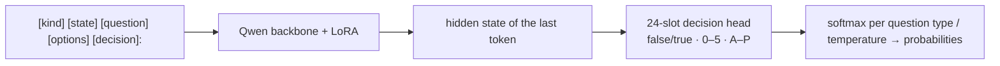

[**🇨🇳中文**](https://github.com/shibing624/train-jev/blob/main/README.md) | [**🌐English**](https://github.com/shibing624/train-jev/blob/main/README_EN.md) | [**📖Docs**](https://github.com/shibing624/train-jev/tree/main/docs) | [**🤖Models**](https://huggingface.co/shibing624/train-jev-27b-lora)

# train-jev

Give it a piece of text and it hands back a probability for every option — not an explanation.

[](https://huggingface.co/shibing624/train-jev-27b-lora)
[](https://github.com/shibing624/train-jev/actions/workflows/ci.yml)
[](https://github.com/shibing624/train-jev/blob/main/LICENSE)
[](https://github.com/shibing624/train-jev/blob/main/requirements.txt)
[](https://github.com/shibing624/train-jev/issues)

**train-jev** is a JEV-style System 1 decision model you train and run yourself: calibrated probabilities in one forward pass.
It sits on a Qwen3.5 / Qwen3.8 backbone as a **LoRA + 24-slot decision head**, first learning Jev v1.13 output distributions and then sharpening its judgments with public gold labels and rule data.

The model does not generate text. It returns a probability for every option: let your code take the confident ones and route the rest to a person.

The server speaks TypeSafe's [System One API](https://docs.typesafe.ai/api) (`POST /v1/systemone`), so code that already calls Jev only needs a new URL.

## What You Get

- **Three question types in one request**: yes/no (`noul`), multiple choice (`choice`) and rating (`score`) answered independently over shared text.
- **Calibrated by default**: per-type temperatures help set thresholds for automation and human review; recalibrate for new domains when needed.
- **Ready to run**: both 4B and 27B LoRA models are on Hugging Face, with one-command serving.
- **Vision capability**: `trainjev.serve --vision` accepts TypeSafe-style image `assets` via JSON/base64 or multipart, with yes/no, choice and score questions on the same `/v1/systemone` endpoint.
- **Measured decision quality**: 27B reaches 79.52% task-macro accuracy on train-jev-pk and 57.01 on the full public Decision Index; 4B reaches 76.03% and 42.00.
- **Train it on your workload**: KL distillation, gold supervision, rule-data replay, multi-GPU DDP / FSDP2, resumable runs and custom-data mixtures.

## Running It in Three Steps

```bash
git clone https://github.com/shibing624/train-jev.git && cd train-jev
pip install -r requirements.txt
python -m trainjev.serve --base Qwen/Qwen3.5-4B --adapter shibing624/train-jev-4b-lora --port 8020
```

The first run downloads the backbone, LoRA, decision head and temperatures. For 27B:

```bash
python -m trainjev.serve --base Qwen/Qwen3.8-27B --adapter shibing624/train-jev-27b-lora --port 8020
```

GPU memory: about 9 GB for 4B (a 24 GB card is enough) and about 54 GB for 27B (an 80 GB card). On CUDA, install `flash-linear-attention`, otherwise Qwen3.5's Gated DeltaNet layers fall back to a slow reference implementation.

### Send a Request

```bash
curl -s localhost:8020/v1/systemone -H 'content-type: application/json' -d '{
  "state": "Shoes arrived two weeks late and in the wrong size. Also I see two charges on my card.",
  "questions": {
    "department": {"type": "choice", "instructions": "Which team should handle this?",
                   "criteria": {"returns": "Exchanges, refunds, wrong or damaged items",
                                "shipping": "Delivery status, delays, lost packages",
                                "billing": "Charges, invoices, payment problems"}},
    "escalate":   {"type": "noul", "instructions": "Does this need urgent human attention?"}
  }}'
```

The response carries a probability for every option, not just a label (response shape below; values are illustrative):

```json
{
  "model": "train-jev-4b-lora",
  "answers": {
    "department": {"type": "choice", "choice": "shipping", "confidence": 0.81,
                   "probabilities": {"returns": 0.07, "shipping": 0.81, "billing": 0.12}},
    "escalate": {"type": "noul", "noul": 0.04}
  },
  "usage": {"input_tokens": 92},
  "latency_ms": 38.7
}
```

One request can carry any number of questions: they share the same state but answer independently. `GET /health` returns the active model name.

Without a server, run a single decision straight from Python:

```bash
python examples/local_inference.py --base Qwen/Qwen3.5-4B --adapter shibing624/train-jev-4b-lora \
  --state "My card was charged twice for one order." --question "Which team should handle this request?" \
  --options billing shipping "technical support"
```

More runnable examples (batch decisions, wide options, images, protocol smoke test) live in [examples/](https://github.com/shibing624/train-jev/tree/main/examples):

```bash
python examples/client.py --url http://127.0.0.1:8020             # one ticket, three question types
python examples/batch_decisions.py --url http://127.0.0.1:8020    # several decisions over the same state
python examples/smoke_systemone.py --url http://127.0.0.1:8020    # three fixed questions with known answers
python examples/wide_choices.py --url http://127.0.0.1:8020 --compare   # 20 options, three read strategies
python examples/image_decisions.py --image door-camera.jpg        # TypeSafe multipart image
```

## Choosing a Model

| Model | Backbone | Trainable parameters | GPU for inference | Download |
|---|---|---:|---|---|
| **shibing624/train-jev-4b-lora** (Ours) | Qwen3.5-4B | LoRA 30.5M + head 61k | 24 GB | [🤗 HF](https://huggingface.co/shibing624/train-jev-4b-lora) |
| **shibing624/train-jev-27b-lora** (Ours) | Qwen3.8-27B | LoRA 108.8M + head 123k | 80 GB | [🤗 HF](https://huggingface.co/shibing624/train-jev-27b-lora) |

4B starts comfortably on a single 24 GB card; 27B is more accurate but wants 80 GB. `--base` and `--adapter` also accept local directories, so you can serve your own checkpoint.

## Results

Ours denotes the current release. Kev, autotrust and official API columns are historical references, not rerun in this round. ↑ higher is better, ↓ lower is better.

| Evaluation | train-jev-4b-lora<br>(Ours) | train-jev-27b-lora<br>(Ours) | Kev-4B | autotrust/JEV-27B-VL | TypeSafe Jev v1.13<br>(official API) |
|---|---:|---:|---:|---:|---:|
| **[train-jev-pk](https://github.com/shibing624/train-jev/tree/main/data/train-jev-pk)** (2,494 questions, 22 tasks) | | | | | |
| Task-macro accuracy ↑ | 76.03% | **79.52%** | 63.50% | 73.47% | – |
| ECE ↓ | 0.0930 | **0.0901** | 0.159 | 0.107 | – |
| **[train-jev-classification-pk](https://github.com/shibing624/train-jev/tree/main/data/train-jev-classification-pk)** (13 scenarios, 1,300 questions) | | | | | |
| Accuracy ↑ | 0.6523 | 0.6938 | 0.640 | 0.690 | **0.700** |
| ECE ↓ | 0.0622 | **0.0377** | 0.083 | 0.094 | 0.130 |
| **[Kev transfer-v4](https://github.com/jaredpalmer/kev)** (656 questions from unseen sources) | | | | | |
| Accuracy ↑ | 0.8201 | 0.8476 | 0.817 | 0.852 | **0.857** |
| ECE ↓ | 0.0588 | 0.0681 | **0.042** | 0.097 | – |
| **[Decision Index 0.3, sampled score](https://github.com/apolinario/decision-index) (6,000 requests)** ↑ | 43.84 | 57.54 | 38.4 | 54.1 | **59.7** |
| **[Decision Index 0.3, full-panel score](https://github.com/apolinario/decision-index) (110,087 requests)** ↑ | 42.00 | **57.01** | – | – | – |

Decision Index is a composite score, not accuracy.

- **Aggregate decision scores improve for both sizes**: against original archived results, full DI rises from 39.01 to 42.00 for 4B and 55.58 to 57.01 for 27B; train-jev-pk accuracy is 76.03% / 79.52%.
- **Adapt the method to your workload**: compact LoRA + head training combines soft-distribution distillation, gold labels and rules, with an end-to-end path through training, calibration, evaluation and serving.

Breakdowns, comparison protocols and limitations are in [the results guide](https://github.com/shibing624/train-jev/blob/main/docs/results.en.md).

## Training on Your Own Data

Both sizes use the same data and method: soft-distribution distillation followed by public gold supervision and independently verified rule examples.

| Training data | Purpose | Processed training rows |
|---|---|---:|
| [SargeDev/jev-distill-corpus-v3](https://huggingface.co/datasets/SargeDev/jev-distill-corpus-v3) | Initial distillation and replay across `choice` / `noul` / `score` | 655,806 |
| [GSM8K](https://huggingface.co/datasets/openai/gsm8k) | Mathematics choice questions with two distractor constructions | 11,148 |
| [PAWS](https://huggingface.co/datasets/google-research-datasets/paws), [AQuA-RAT](https://huggingface.co/datasets/deepmind/aqua_rat), [QASC](https://huggingface.co/datasets/allenai/qasc), [HelpSteer2](https://huggingface.co/datasets/nvidia/HelpSteer2) | Paraphrases, mathematics/science choices and correctness ratings | 15,999 |
| Independently verified rules (CC0) | Routing, evidence, coreference, refund conversion, calendars and condition counting | 10,000 |

The current release further uses 12,947 admitted rows from [tasksource typed-decisions](https://huggingface.co/datasets/tasksource/tasksource-jev-typed-decisions), spanning commonsense, reading, soft vote labels, entities and legal tasks, on top of distillation, gold labels and rules. Sampling differs by phase; the old 12.5% recipe does not describe the whole current run. Actual exposures and settings are in `training_recipe.json`. This publication retains each model's existing calibration rather than refitting on the new evaluations.

```bash
# Initial distillation: download data and backbone, then train
bash scripts/prepare_data.sh
GPUS=0,1,2 bash scripts/run_train.sh

# Initial distillation for 27B
BASE_REPO=Qwen/Qwen3.8-27B BASE_DIR=models/Qwen3.8-27B bash scripts/prepare_data.sh
GPUS=0,1,2,3 bash scripts/run_train_27b.sh
```

These scripts distill from the Qwen backbone; mix public gold or your own JSONL data to train a business model. The [training guide](https://github.com/shibing624/train-jev/blob/main/docs/training.en.md) covers the full workflow, a runnable PAWS conversion example, resuming and calibration. Published models use a broader gold-and-rule mixture; settings are in the HF package's `training_recipe.json`.

For custom data, prepare JSONL with one question and target distribution per line, then mix it in with `--mix mydata.jsonl:2`:

```json
{"kind": "choice", "state": "...", "question": "Which team should handle this?", "options": ["billing", "infra", "product"], "target": [0.05, 0.90, 0.05], "weight": 1.0}
```

## How It Works



The head is initialized from the corresponding backbone `lm_head` token rows, preserving the backbone's starting judgments. Initial training uses KL to teacher distributions, an ordinal RPS loss for ratings and shuffled choice options to reduce position bias. Details are in [the training guide](https://github.com/shibing624/train-jev/blob/main/docs/training.en.md).

## Documentation

| Document | Contents |
|---|---|
| [Serving](https://github.com/shibing624/train-jev/blob/main/docs/serving.en.md) | Server flags, API, examples, wide choices and images |
| [Training](https://github.com/shibing624/train-jev/blob/main/docs/training.en.md) | Data, recipes, resuming, calibration, memory, speed and backbones |
| [Evaluation](https://github.com/shibing624/train-jev/blob/main/docs/evaluation.en.md) | Running and reproducing the evaluation suites |
| [Results](https://github.com/shibing624/train-jev/blob/main/docs/results.en.md) | Breakdowns, comparisons and limitations |

## Roadmap

- [x] Train, evaluate and release Qwen3.5-4B / Qwen3.8-27B LoRA models on Hugging Face
- [x] Add public gold and rule data; 27B beats autotrust/JEV-27B-VL on train-jev-pk
- [ ] Broader public gold-labelled data to close the knowledge and language gaps to TypeSafe Jev v1.13
- [ ] Full fine-tune of Qwen3.8-27B
- [x] TypeSafe image assets in `/v1/systemone` (JSON/base64 and multipart)

## Citation

```bibtex
@misc{train-jev,
  title={train-jev: Training JEV-style Decision Models},
  author={Ming Xu},
  year={2026},
  howpublished={\url{https://github.com/shibing624/train-jev}}
}
```

## Contact

- Issues: [](https://github.com/shibing624/train-jev/issues)
- Email: xuming624@qq.com
- WeChat group: add `xuming624` with the note "llm"


Contributions are welcome; see [CONTRIBUTING.md](https://github.com/shibing624/train-jev/blob/main/CONTRIBUTING.md).

## Acknowledgements

- [autotrust/JEV-27B-VL](https://huggingface.co/autotrust/JEV-27B-VL) for the public model weights,
- [SargeDev/jev-distill-corpus-v3](https://huggingface.co/datasets/SargeDev/jev-distill-corpus-v3) for the training corpus,
- [jaredpalmer/kev](https://github.com/jaredpalmer/kev) for evaluation suites and reference models,
- [Decision Index](https://github.com/apolinario/decision-index), and [Qwen](https://huggingface.co/Qwen) for the backbones.

This is an independent research reproduction, not affiliated with TypeSafe AI or autotrust.

## License

Code: [Apache-2.0](https://github.com/shibing624/train-jev/blob/main/LICENSE). The Qwen backbones are also Apache-2.0; training and evaluation data keep their own licenses.
