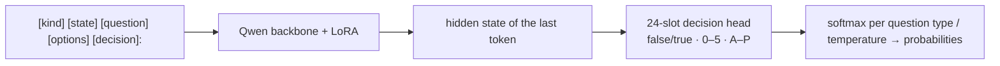

[**🇨🇳中文**](README.md) | [**🌐English**](README_EN.md) | [**📖Docs**](docs/) | [**🤖Models**](https://huggingface.co/shibing624/train-jev-27b-lora)

# train-jev

JEV-style decision models you can train and run yourself: calibrated probabilities in one forward pass.

[](https://huggingface.co/shibing624/train-jev-27b-lora)
[](https://github.com/shibing624/train-jev/actions/workflows/ci.yml)
[](LICENSE)
[](requirements.txt)
[](https://github.com/shibing624/train-jev/issues)

**train-jev** is an open reproduction of the System 1 decision-model recipe behind JEV (TypeSafe Jev v1.13): a **LoRA +
24-slot decision head** on a Qwen3.5 / Qwen3.8 backbone, KL-distilled from the full output distributions of Jev v1.13.
The model does not generate text. It returns a **probability for every option** in one forward pass, so you can use it
as a confidence score: let your code handle the confident cases and send the rest to a person.

The server speaks TypeSafe's [System One API](https://docs.typesafe.ai/api) (`POST /v1/systemone`), so code that
already calls Jev only needs a new URL.

## Highlights

- **Three question types in one request**: yes/no (`noul`), multiple choice (`choice`) and rating (`score`). The
  questions share the text but are answered independently and can't read each other.
- **Calibrated by default**: every model ships with per-type temperatures, so you can put thresholds on the
  probabilities directly.
- **Ready-to-run weights**: both v0.3.0 LoRA models are published on Hugging Face; one command to serve.
- **The 27B model beats autotrust/JEV-27B-VL**: 78.7% vs 73.5% task-macro accuracy on a sealed 2,494-question PK
  (paired +5.25pp, 95% interval [4.01, 6.50]), ahead on public gold, legacy classification and rules; transfer-v4 ECE 0.032 vs 0.097.
- **It can see**: trained on text only with the vision encoder left untouched, the model makes zero-shot decisions
  about images.
- **Train and deploy**: a single-file trainer, multi-GPU DDP / FSDP2, resumable runs; switch backbones with `--base`.

## Models

| Model | Version | Backbone | Trainable parameters | GPU for inference | Download |
|---|---|---|---:|---|---|
| **shibing624/train-jev-4b-lora** (Ours) | v0.3.0 | Qwen3.5-4B | LoRA 30.5M + head 61k | 24 GB | [🤗 HF](https://huggingface.co/shibing624/train-jev-4b-lora) |
| **shibing624/train-jev-27b-lora** (Ours) | v0.3.0 | Qwen3.8-27B | LoRA 108.8M + head 123k | 80 GB | [🤗 HF](https://huggingface.co/shibing624/train-jev-27b-lora) |

Both repositories serve v0.3.0 on main and under the `v0.3.0` tag; the previous weights stay under the `v0.2.0` tag,
loadable with `--adapter_revision v0.2.0`.

## Results

Every model answers **the same questions**. ↑ higher is better, ↓ lower is better. Both train-jev columns are **v0.3.0**.

| Evaluation | train-jev-4b-lora<br>(Ours) | train-jev-27b-lora<br>(Ours) | Kev-4B | autotrust/JEV-27B-VL | TypeSafe Jev v1.13<br>(official API) |
|---|---:|---:|---:|---:|---:|
| **Sealed same-question PK** (2,494 questions, 22 tasks, 2026-10-17) | | | | | |
| task-macro accuracy ↑ | 74.18% | **78.72%** | 63.50% | 73.47% | – |
| public gold (PAWS / AQuA / QASC / HelpSteer2) ↑ | 63.25% | **70.65%** | 56.70% | 62.24% | – |
| legacy classification (12 tasks) ↑ | 69.89% | **74.89%** | 70.11% | 72.67% | – |
| exact rules (6 families) ↑ | 90.06% | **91.77%** | 54.79% | 82.57% | – |
| calibrated NLL ↓ | 0.751 | **0.629** | 1.018 | 0.761 | – |
| ECE ↓ | 0.112 | **0.098** | 0.159 | 0.107 | – |
| **13-dataset classification PK** (1,300 questions) | | | | | |
| accuracy ↑ | 0.642 | 0.687 | 0.640 | 0.690 | **0.700** |
| ECE ↓ | 0.050 | **0.048** | 0.083 | 0.094 | 0.130 |
| accuracy on the 8 sources Kev never saw ↑ | 0.600 | 0.640 | 0.570 | **0.645** | **0.645** |
| **Kev transfer-v4** (656 questions from unseen sources) | | | | | |
| accuracy ↑ | 0.805 | **0.858** | 0.817 | 0.852 | 0.857 |
| ECE ↓ | 0.054 | **0.032** | 0.042 | 0.097 | – |
| NLL ↓ | 0.596 | **0.377** | 0.435 | 0.460 | – |
| **Decision Index 0.3, historical sample** (35 benchmarks, 6,000 questions) ↑ | 41.5 | 56.1 | 38.4 | 54.1 | **59.7** |
| **Decision Index 0.3, full public text panel** (37 benchmarks, 110,087 requests, `single`) ↑ | 39.01 | **55.58** | – | – | – |
| **Distillation fidelity** (jev-distill, raw logits) | | | | | |
| in-distribution KL ↓ | 0.023 | **0.019** | 0.387 | 0.021 | – |
| out-of-distribution KL ↓ | 0.483 | 0.123 | 0.624 | **0.108** | – |
| **Zero-shot image decisions** (5 vision sets) ↑ | 0.693 | 0.765 | not supported | **0.782** | – |
| single-question p50 latency | 42 ms | 151 ms | **17 ms** | 96 ms | 370 ms (incl. network) |

- **train-jev-27b-lora beats autotrust/JEV-27B-VL**: paired task-macro **+5.25pp [4.01, 6.50]** on the sealed PK; public gold
  +8.41pp, legacy classification +2.22pp [0.61, 3.90], rules +9.20pp; transfer-v4 accuracy 0.858 vs 0.852, ECE 0.032 vs 0.097,
  NLL 0.377 vs 0.460. Historical 35-panel Decision Index 56.1 vs 54.1 (27B v0.2.0: 54.6); 37-benchmark full panel 53.88 → 55.58. It is still slightly behind on image decisions and OOD KL.
- **train-jev-4b-lora leads Kev-4B at the same size**: sealed PK +10.69pp [8.89, 12.59], historical 35-panel Decision Index
  41.5 vs 38.4; transfer-v4 accuracy 0.805 vs 0.817 is slightly lower, with better ECE. The 4B model ties JEV-27B-VL on the
  sealed PK (+0.71pp [−0.82, 2.34]).
- Gaps: the TypeSafe Jev v1.13 API is still best on the 13-dataset PK and the historical 35-panel Decision Index.
- The full Decision Index run covers only the public 37-benchmark scoreable text panel, not the private Full leaderboard, and is not mixed with the historical 35-benchmark sample. JEV-27B-VL has no full-panel result, so no full-panel comparison is claimed.
- The sealed PK's rule tasks are fresh instances of the rule families used in v0.3.0 training, and its public-gold tasks come
  from four sources seen in training (different items). Those leads show in-distribution learning, not generalisation to
  unseen rules or sources; transfer-v4, the 13-dataset PK and Decision Index are the out-of-distribution checks.
- OOD KL measures closeness to the Jev v1.13 teacher distribution. With gold supervision added it rises from 0.311 to 0.483
  (4B) and 0.110 to 0.123 (27B) without lower accuracy (4B OOD choice top-1 0.888→0.900). Distillation KL uses raw logits
  because the v0.3.0 temperatures are fitted on a gold calibration set.
- Latency: train-jev rows are in-process merged-BF16, one question per forward. Kev-4B, JEV-27B-VL and the Jev API keep their
  v0.2.0-era measurements, so compare orders of magnitude only.

v0.2.0 → v0.3.0 comparisons, the recipe and checkpoint selection are in [v0.3.0](#v030-continued-training-with-gold-and-rule-data);
all breakdowns are in [docs/results.en.md](https://github.com/shibing624/train-jev/blob/main/docs/results.en.md).

## Quick Start

### Install

```bash
git clone https://github.com/shibing624/train-jev.git && cd train-jev
pip install -r requirements.txt
```

### Start a server

```bash
python -m trainjev.serve --base Qwen/Qwen3.5-4B --adapter shibing624/train-jev-4b-lora --port 8020
```

The first run downloads the backbone, the LoRA, the decision head and the temperatures. For 27B use
`--base Qwen/Qwen3.8-27B --adapter shibing624/train-jev-27b-lora`.

### Send a ticket

```bash
curl -s localhost:8020/v1/systemone -H 'content-type: application/json' -d '{
  "state": "Shoes arrived two weeks late and in the wrong size. Also I see two charges on my card.",
  "questions": {
    "department":  {"type": "choice", "instructions": "Which team should handle this?",
                    "criteria": {"returns": "Exchanges, refunds, wrong or damaged items",
                                 "shipping": "Delivery status, delays, lost packages",
                                 "billing": "Charges, invoices, payment problems"}},
    "escalate":    {"type": "noul",  "instructions": "Does this need urgent human attention?"},
    "frustration": {"type": "score", "instructions": "How frustrated is the customer?",
                    "criteria": ["Calm", "Frustrated", "Very angry"]}
  }}'
```

Actual response from train-jev-4b-lora (probabilities rounded to two decimals):

```json
{
  "answers": {
    "department":  {"type": "choice", "choice": "returns",
                    "probabilities": {"returns": 0.68, "shipping": 0.15, "billing": 0.17}},
    "escalate":    {"type": "noul", "noul": 0.66},
    "frustration": {"type": "score", "score": 1.18,
                    "probabilities": {"0": 0.00, "1": 0.82, "2": 0.18}}
  }
}
```

The ticket mentions a wrong item, a late delivery and a double charge, and the department probabilities say so.
That's why the model returns probabilities instead of a single label: your code can act on the confident answers and
route the rest to a person.

### Call it from Python

```python
import httpx

resp = httpx.post("http://127.0.0.1:8020/v1/systemone", json={
    "state": "I was charged twice. Please fix this ASAP.",
    "questions": {
        "billing": {"type": "noul", "instructions": "Is this ticket about billing?"},
        "tone": {"type": "choice", "instructions": "What is the customer's tone?",
                 "criteria": {"calm": None, "frustrated": None, "angry": None}},
    },
}, timeout=60).json()

if resp["answers"]["billing"]["noul"] > 0.9:
    print("route to billing:", resp["answers"]["tone"]["choice"])
```

More examples are in [examples/](https://github.com/shibing624/train-jev/blob/main/examples/) and the
[serving guide](https://github.com/shibing624/train-jev/blob/main/docs/serving.en.md).

## Train on Your Own Data

Training data is jsonl, one question with a target distribution per line:

```json
{"kind": "choice", "state": "...", "question": "Which team should handle this?",
 "options": ["billing", "infra", "product"], "target": [0.05, 0.90, 0.05], "weight": 1.0}
```

```bash
bash scripts/prepare_data.sh                       # jev-distill corpus + Qwen3.5-4B backbone
GPUS=0,1,2 bash scripts/run_train.sh               # 4B: about 2.8 h on 3x H20
GPUS=0,1,2,3 bash scripts/run_train_27b.sh         # 27B: about 33 h on 4x H20
```

Mix in your own data with `--mix mydata.jsonl:2`. The recipe, resuming, temperature calibration and memory sizing are
in [docs/training.en.md](https://github.com/shibing624/train-jev/blob/main/docs/training.en.md).

## How It Works



The 24 head rows are initialised from the backbone's `lm_head` rows of those tokens (`false/true`, `0–5`, `A–P`), so
at step 0 the model already gives the backbone's own judgement, and training only sharpens it. The loss is KL to the
teacher distribution, plus 0.5 × an ordinal RPS term on rating questions; 30% of choice questions have their options
shuffled so the model answers by content, not position. Details: [docs/training.en.md](docs/training.en.md).

## v0.3.0: continued training with gold and rule data

4B and 27B use **the same recipe**, continuing from their own v0.2.0 LoRA + head with a fresh optimizer.
The new pool combines two GSM8K distractor views, PAWS, AQuA-RAT, QASC, HelpSteer2 and independently verified
rule/evidence/coreference/refund/calendar/counting examples: **87.5% original distillation replay and 12.5% new supervision
per step**, LoRA / head learning rates 2e-5 / 4e-5, seed 17, a 2,048-step schedule. Inputs carry no reference solutions or
teacher-generated text. Checkpoints were picked on a separate development set only (highest macro gain without a
>16-option regression); both sizes picked **step 512**.

| Run | Hardware | Steps run | Released checkpoint | Time |
|---|---|---:|---:|---:|
| 4B | 3×H20, no gradient checkpointing | 2,048 | 512 | 1.3 h |
| 27B | 3×H20, gradient checkpointing, micro-token 16,384 | 1,024 | 512 | 7.9 h |

**Sealed same-question PK** (2,494 questions, 22 tasks; both checkpoints were chosen before scoring; not Decision Index scores):

| Metric | 4B v0.2.0 | **4B v0.3.0** | 27B v0.2.0 | **27B v0.3.0** | Kev-4B | JEV-27B-VL |
|---|---:|---:|---:|---:|---:|---:|
| Task-macro accuracy | 63.59% | 74.18% | 73.99% | **78.72%** | 63.50% | 73.47% |
| Public gold | 57.03% | 63.25% | 63.41% | **70.65%** | 56.70% | 62.24% |
| Legacy classification | 70.22% | 69.89% | 73.44% | **74.89%** | 70.11% | 72.67% |
| Exact rules | 54.69% | 90.06% | 82.14% | **91.77%** | 54.79% | 82.57% |
| Calibrated NLL ↓ | 1.050 | 0.751 | 0.725 | **0.629** | 1.018 | 0.761 |
| ECE ↓ | 0.165 | 0.112 | 0.117 | **0.098** | 0.159 | 0.107 |
| Counterfactual pair both-correct | 0.346 | 0.866 | 0.742 | **0.892** | 0.330 | 0.746 |
| Option-rotation consistency | 0.844 | **0.911** | 0.901 | 0.901 | 0.870 | 0.880 |
| Single-question latency p50 / p95 (ms) | – | 42 / 100 | – | 151 / 353 | 97 / 251 | 135 / 324 |

Paired task-macro difference (group-bootstrap 95% interval):

| Comparison | All | Public gold | Legacy | Rules |
|---|---:|---:|---:|---:|
| 4B v0.3.0 − 4B v0.2.0 | **+10.60** [9.44, 11.77] | +6.22 | −0.33 | +35.38 |
| 27B v0.3.0 − 27B v0.2.0 | **+4.73** [3.71, 5.80] | +7.24 | +1.44 [0.37, 2.66] | +9.63 |
| 27B v0.3.0 − JEV-27B-VL | **+5.25** [4.01, 6.50] | +8.41 | +2.22 [0.61, 3.90] | +9.20 |
| 4B v0.3.0 − Kev-4B | **+10.69** [8.89, 12.59] | +6.55 | −0.22 | +35.27 |
| 4B v0.3.0 − JEV-27B-VL | +0.71 [−0.82, 2.34] | +1.02 | −2.78 [−5.25, −0.42] | +7.49 |

- **Where the gain comes from**: about nine tenths of the 4B gain is the rule tasks; the 27B gain is more even, with public gold
  +7.2pp and a significant legacy gain. In controls, continuing training without new data (D0) gave 0 and GSM8K alone was not
  significant, so the gain comes from the public-gold + rule data, not extra steps.
- **Out-of-distribution checks**: Decision Index 37-panel full run 4B 37.40 → 39.01 (paired question-level +0.97pp [0.78, 1.17],
  25 up / 10 down, three benchmarks including #38 significantly down) and 27B 53.88 → 55.58 (paired question-level macro-accuracy diagnostic +1.03pp [0.86, 1.20], 30 up / 6 down / 1 equal,
  all five areas up); transfer-v4 accuracy 4B 0.779 → 0.805 and 27B
  0.851 → 0.858, ECE lower for both; 13-dataset PK flat for 4B (24 / 30 discordant, p=0.50) and 0.678 → 0.687 for 27B
  (25 / 13, p=0.073). Out-of-distribution gains are much smaller than on the sealed PK.
- **Limits**: rule items share families with training, public-gold sources appear in training (different items), one seed per
  size. Every model runs its own native stack with shipped temperatures; external models were not retrained or recalibrated.
  Latencies are from the same H20 but different stacks.
  Question-level accuracy intervals are diagnostics, not confidence intervals for the DI index. Per-benchmark McNemar tests are not corrected for multiple comparisons; not every task improves.
- Details: [reports/v0.3.0/external_final2.json](reports/v0.3.0/external_final2.json) (six models, per task),
  [reports/v0.3.0/final_pk.json](reports/v0.3.0/final_pk.json) (4B release acceptance),
  [reports/v0.3.0/di37_results.json](reports/v0.3.0/di37_results.json) (full DI results and audit),
  [docs/results.en.md §13](docs/results.en.md#13-v030-continued-training-with-gold-and-rule-data).

## Documentation

| Document | Contents |
|---|---|
| [docs/serving.en.md](https://github.com/shibing624/train-jev/blob/main/docs/serving.en.md) | Serving and inference: server flags, API format, examples, choices with more than 16 options |
| [docs/training.en.md](https://github.com/shibing624/train-jev/blob/main/docs/training.en.md) | Recipe, data format, resuming, calibration, memory and speed, other backbones |
| [docs/evaluation.en.md](https://github.com/shibing624/train-jev/blob/main/docs/evaluation.en.md) | How to run and reproduce the five evaluation suites |
| [docs/results.en.md](https://github.com/shibing624/train-jev/blob/main/docs/results.en.md) | All results, breakdowns and limitations |

## Roadmap

- [x] Train, evaluate and release Qwen3.5-4B / Qwen3.8-27B LoRA models on Hugging Face (v0.2.0)
- [x] Continue training with public gold and rule data; 27B beats JEV-27B-VL on the sealed PK (v0.3.0)
- [ ] Broader public gold-labelled data to close the knowledge and language gaps to TypeSafe Jev v1.13
- [ ] Full fine-tune of Qwen3.8-27B
- [ ] Image inputs in the `/v1/systemone` server

### v0.4.0: memory-write decisions (separate from the frozen v0.3.0 recipe)

- [ ] Export the actual SDK schema, complete labels, request templates and probability fields; reproduce real requests, retain the 8 confirmed failures as regression cases, and investigate RPC timeouts separately.
- [ ] Build group-isolated positive and negative memory-write examples covering facts, chat, duplicates/updates/contradictions, quoted/tool content, privacy and non-persistence constraints; distil full Jev 1.13 teacher distributions with label review rather than equating agreement with correctness.
- [ ] Treat derived-memory extraction as a separate generator or System Two task with source evidence; System One classification does not generate memory text, and output count alone is not a quality metric.
- [ ] Evaluate write precision/recall, label macro F1, calibration, derived-fact coverage, duplication and hallucination on a larger independent holdout; 8 regression cases are not evidence of generalization.

## Citation

```bibtex
@misc{train-jev,
  title={train-jev: Training JEV-style Decision Models},
  author={Ming Xu},
  year={2026},
  howpublished={\url{https://github.com/shibing624/train-jev}}
}
```

## Contact

- Issues: [](https://github.com/shibing624/train-jev/issues)
- Email: xuming624@qq.com
- WeChat group: add `xuming624` with the note "llm"


Contributions are welcome; see [CONTRIBUTING.md](https://github.com/shibing624/train-jev/blob/main/CONTRIBUTING.md).

## Acknowledgements

- [autotrust/JEV-27B-VL](https://huggingface.co/autotrust/JEV-27B-VL) for the public recipe,
- [SargeDev/jev-distill-corpus-v3](https://huggingface.co/datasets/SargeDev/jev-distill-corpus-v3) for the training corpus,
- [jaredpalmer/kev](https://github.com/jaredpalmer/kev) for its evaluation suites and reference models,
- [Decision Index](https://github.com/apolinario/decision-index), and [Qwen](https://huggingface.co/Qwen) for the backbones.

This is an independent research reproduction, not affiliated with TypeSafe AI or autotrust.

## License

Code: [Apache-2.0](https://github.com/shibing624/train-jev/blob/main/LICENSE). The Qwen backbones are also Apache-2.0; training and evaluation data keep their own licenses.
